# Especificación de requisitos de software (SRS)
**Electrostock: plataforma de gestión operativa para talleres de vehículos eléctricos livianos**

| Campo | Valor |
|---|---|
| Norma de estructura | IEEE Std 830-1998, *Recommended Practice for Software Requirements Specifications* |
| Normas complementarias | ISO/IEC/IEEE 29148:2018 (sucesora de IEEE 830), ISO/IEC 25010:2023, UML 2.5.1 |
| Versión | 3.0 (reorganización a IEEE 830 de la versión 2.0) |
| Fecha | 2 de noviembre de 2026 |
| Autores | Santiago Andrés Fonseca Rojas, Carlos Leonardo López Cárdenas, Joseph Andrés Helmont Rico |
| Estado de evidencia | **Diseñado** (fase sin código) |
| Diagramas | Figma [Ingeniería de software: todo visual](https://www.figma.com/design/VuBSMD14Jm4Dt45rAGXTWd/Ingenieria-software-todovisual?node-id=11-2) (26 diagramas codificados) |

> [!info] Documentos relacionados
> - Historias de usuario: [[IS-2-HU]]
> - Diseño de interfaz (wireframes y mockups): [[IS-4-diseno-interfaz]]
> - Pruebas y trazabilidad: [[IS-5-pruebas]]
> - Arquitectura: [[AR-1-SAD]] y decisiones [[AR-2-ADR]]

## Tabla de contenido

1. [[#1. Introducción|Introducción]]
   - 1.1 Propósito · 1.2 Alcance · 1.3 Definiciones, acrónimos y abreviaturas · 1.4 Referencias · 1.5 Visión general del documento
2. [[#2. Descripción general|Descripción general]]
   - 2.1 Perspectiva del producto · 2.2 Funciones del producto · 2.3 Características de los usuarios · 2.4 Restricciones · 2.5 Suposiciones y dependencias · 2.6 Prorrateo de requisitos
3. [[#3. Requisitos específicos|Requisitos específicos]]
   - 3.1 Interfaces externas · 3.2 Requisitos funcionales · 3.3 Requisitos de rendimiento · 3.4 Requisitos lógicos de la base de datos · 3.5 Restricciones de diseño · 3.6 Atributos del sistema de software · 3.7 Organización de los requisitos y modelos de análisis · 3.8 Información adicional
4. Apéndices
   - [[#Apéndice A. Identificación de la necesidad|A. Identificación de la necesidad]] · [[#Apéndice B. Matriz de trazabilidad|B. Matriz de trazabilidad]] · [[#Apéndice C. Correspondencia con ISO 29148 y con la versión anterior|C. Correspondencia normativa]] · [[#Apéndice D. Índice de figuras|D. Índice de figuras]]

---

## 1. Introducción

### 1.1 Propósito
Este documento especifica de forma completa y verificable los requisitos de **Electrostock**. Sirve para:
1. acordar con el cliente académico qué debe hacer el sistema;
2. planear las historias de usuario ([[IS-2-HU]]);
3. diseñar la arquitectura ([[AR-1-SAD]]);
4. derivar los casos de prueba ([[IS-5-pruebas]]).

**Audiencia:** docentes evaluadores de Ingeniería de Software y Arquitectura de Software, los tres desarrolladores del equipo y cualquier persona que mantenga el sistema después.

### 1.2 Alcance

**Nombre del producto:** Electrostock.

**Necesidad que atiende.** Los talleres de vehículos eléctricos livianos aceptan servicios que no pueden atender, porque su agenda no está coordinada con el inventario ni con la capacidad de los mecánicos. El equipo lo vivió directamente: una espera de 7 horas que terminó sin solución porque la parte eléctrica requerida no estaba en el taller. El análisis completo está en el [[#Apéndice A. Identificación de la necesidad|Apéndice A]].

**Qué hace el producto.** Es una aplicación web responsive que vincula la agenda del taller con su inventario. Al agendar, verifica que existan los repuestos requeridos por el servicio y los **reserva lógicamente**. El taller solo confirma citas que puede atender de inmediato con el material disponible.

> Declaración de visión: *Para el taller de vehículos eléctricos que pierde capacidad por vehículos detenidos esperando repuestos, Electrostock es una plataforma de gestión operativa que confirma únicamente servicios con insumos garantizados. A diferencia de una agenda convencional o una hoja de cálculo de inventario, Electrostock reserva los repuestos en el mismo instante en que se agenda la cita.*

**Qué no hace el producto** (detalle en [[#2.6 Prorrateo de requisitos|2.6]]): no envía correos ni SMS reales, no emite facturación electrónica, no imprime en impresora térmica, no almacena fotos, no procesa pagos en línea, no maneja varias sedes y no es una aplicación móvil nativa.

**Beneficios y objetivos de negocio**

| ID | Objetivo | Indicador | Meta |
|---|---|---|---|
| OB-01 | Eliminar citas confirmadas sin repuesto disponible | % de citas confirmadas que inician reparación sin estado *Esperando Repuesto* por falta de stock reservado | ≥ 95 % |
| OB-02 | Reducir la ocupación improductiva de bahías | Horas-bahía en *Esperando Repuesto* por semana | Reducción ≥ 50 % frente a la línea base que se mida al iniciar la operación |
| OB-03 | Reducir llamadas de seguimiento | Consultas de estado resueltas en el portal frente a llamadas | ≥ 70 % por portal |
| OB-04 | Inventario confiable | Diferencia entre stock físico del sistema y conteo físico | ≤ 2 % |
| OB-05 | Trazabilidad total | Órdenes con historial completo de estados y usuarios | 100 % |

**Contexto operativo**
- **Una sola sede** (taller local). Ver ADR-02 en [[AR-2-ADR]].
- **Vehículos atendidos:** bicicletas, scooters, patinetas, motos, monoruedas, microcoches y cuadriciclos, todos eléctricos.
- **Identificador del vehículo:** número de serie o chasis, obligatorio y único. La placa es opcional y única si existe; patinetas, monoruedas y bicicletas no llevan placa.
- **Cuatro roles:** Cliente, Secretaria (recepción), Mecánico y Administrador.

**Módulos funcionales**

| Módulo | Propósito | HU principales |
|---|---|---|
| Identidad | Registro, sesión, usuarios internos, autorización por rol | HU-10, HU-15, HU-21 |
| Clientes y vehículos | Alta de clientes y vehículos, expediente técnico, historial | HU-06, HU-22, HU-30 |
| Catálogo | Servicios, tarifas, duración, repuestos requeridos por servicio, tipos de falla | HU-04, HU-18, HU-26 |
| Agenda | Franjas, citas, bloqueo temporal, reprogramación, cola sin cita, calendario | HU-01, HU-02, HU-03, HU-11, HU-12, HU-28 |
| Inventario | Repuestos, stock físico, reservado y disponible, reservas, entradas, bajas, alertas | HU-08, HU-19, HU-27, HU-29 |
| Órdenes de trabajo | Ciclo de vida de la reparación, asignación, diagnóstico, consumo, seguimiento público | HU-05, HU-07, HU-09, HU-23, HU-24, HU-25 |
| Facturación | Liquidación, pago, comprobante, ticket, encuesta | HU-13, HU-16, HU-17 |
| Reportes | Indicadores operativos y de inventario | HU-14 |
| Auditoría | Bitácora inmutable de cambios | HU-20 |

**Alcance de esta fase (POC).** El POC implementa **12 HU**, repartidas en partes iguales por esfuerzo. Detalle en [[AR-3-POC]].

| Integrante | HU | Esfuerzo total |
|---|---|---|
| Carlos Leonardo López Cárdenas | HU-01, HU-03, HU-22, HU-26 | 18 |
| Joseph Andrés Helmont Rico | HU-05, HU-11, HU-19, HU-23 | 19 |
| Santiago Andrés Fonseca Rojas | HU-06, HU-07, HU-21, HU-28 | 18 |

Las demás HU quedan **especificadas y modeladas**; sus datos existen como semilla y sus pantallas no se implementan en esta fase.

**Criterios de éxito del POC**
1. Un cliente agenda una cita y el sistema rechaza la segunda solicitud concurrente sobre el último cupo (prueba JMeter).
2. Al confirmar la cita, el stock reservado del repuesto requerido aumenta y el disponible disminuye.
3. Al vencer el bloqueo de 5 minutos o la tolerancia de 15 minutos, la reserva se libera sola.
4. La secretaria crea la orden desde la cita y la reserva pasa a la orden.
5. El mecánico avanza la orden y el cliente ve el cambio en el portal público en menos de 2 segundos (SSE).
6. La demo funciona sin backend gracias al modo mock ([[IS-5-pruebas#3. Datos de prueba|datos de prueba]]).

### 1.3 Definiciones, acrónimos y abreviaturas

| Término | Definición |
|---|---|
| Bahía | Puesto de trabajo del taller donde se atiende un vehículo. Determina la capacidad de cada franja |
| Franja | Intervalo de 1 hora del horario del taller. Su capacidad es el número de bahías activas |
| Cita | Promesa de capacidad e insumos para una fecha y hora. No es el trabajo real |
| Orden de trabajo (OT) | Registro del trabajo real sobre un vehículo, de *Ingresada* a *Entregada* |
| Stock físico | Unidades que existen en bodega |
| Stock reservado | Unidades comprometidas con citas u órdenes y aún no instaladas |
| Disponible | Stock físico menos stock reservado |
| Reserva lógica | Compromiso de unidades en el sistema sin moverlas físicamente |
| Ingreso sin cita (walk-in) | Vehículo que llega sin cita previa |
| Triage | Clasificación del ingreso sin cita por tipo de falla, que fija prioridad y duración |
| Código de seguimiento | Código aleatorio de 10 caracteres que permite consultar una orden sin sesión |
| Outbox | Tabla de mensajes pendientes que un proceso despacha después, con reintentos |
| Semáforo | Indicador de ocupación de una franja: verde, amarillo o rojo |
| API | Interfaz de programación de aplicaciones |
| BMS | *Battery Management System*, tarjeta de gestión de la batería |
| COP | Peso colombiano |
| CU / UC | Caso de uso |
| DoR / DoD | *Definition of Ready* / *Definition of Done* |
| FK / PK / UQ | Clave foránea / clave primaria / restricción de valor único |
| HU | Historia de usuario |
| IVA | Impuesto al valor agregado |
| POC | Prueba de concepto (*Proof of Concept*) |
| RBAC | Control de acceso basado en roles |
| RF / RNF / RN | Requisito funcional / no funcional / regla de negocio |
| SKU | Código único de un repuesto |
| SPA | Aplicación web de una sola página |
| SRS | Especificación de requisitos de software |
| SSE | *Server-Sent Events*, canal de eventos del servidor al navegador |
| UUID | Identificador único universal (versión 7, ordenable en el tiempo) |

El glosario completo de arquitectura está en [[AR-1-SAD#12. Glosario|SAD 12]] y el diccionario de nombres de código en [[AR-1-SAD#2.4 Diccionario de nombres|SAD 2.4]].

### 1.4 Referencias

| Referencia | Uso en este documento |
|---|---|
| IEEE Std 830-1998, *Recommended Practice for Software Requirements Specifications* | Estructura del documento y características de un buen SRS |
| ISO/IEC/IEEE 29148:2018, *Requirements engineering* | Norma sucesora; contenido de información y atributos de cada requisito |
| ISO/IEC 25010:2023, *Product quality model* | Clasificación de los requisitos no funcionales |
| ISO/IEC/IEEE 29119, *Software testing* | Plan de pruebas ([[IS-5-pruebas]]) |
| OMG UML 2.5.1 | Notación de los modelos de análisis |
| WCAG 2.2 | Accesibilidad de la interfaz |
| RFC 9457 (*Problem Details*) y RFC 9110 (HTTP) | Formato de errores y códigos de estado |
| Ley 1581 de 2012 (Colombia) | Protección de datos personales |
| [[informacion general del proyecto]] | Especificación original del proyecto |
| [[HU-propuesta]] | Backlog original de historias de usuario |
| [[AR-2-ADR]] | Decisiones de arquitectura citadas como ADR-XX |

### 1.5 Visión general del documento
- **Sección 2** describe el producto en términos generales: contexto, funciones, usuarios, restricciones y supuestos. No contiene requisitos verificables.
- **Sección 3** contiene los requisitos específicos verificables: interfaces, reglas de negocio, requisitos funcionales, rendimiento, base de datos, restricciones de diseño, atributos de calidad y los modelos de análisis UML.
- **Apéndices:** A desarrolla la identificación de la necesidad; B, la trazabilidad; C, la correspondencia con ISO 29148 y con la versión anterior; D, el índice de figuras.

**Características de calidad de este SRS (IEEE 830, sección 4.3)**

| Característica | Cómo se asegura |
|---|---|
| Correcto | Cada requisito se origina en una HU o una regla de negocio y se valida con su criterio de aceptación |
| Inequívoco | Formato "El sistema debe..."; términos definidos en 1.3; umbrales numéricos explícitos |
| Completo | Cubre las 30 HU; los requisitos sin pantalla (HU-10, HU-12, HU-28) también tienen RF |
| Consistente | Un solo identificador por regla, citado desde RF, HU, modelos y pruebas |
| Clasificado por importancia y estabilidad | Columna de prioridad en cada RF y estabilidad por módulo en 3.2.10 |
| Verificable | Cada RF y RNF tiene método de verificación y caso de prueba asociado ([[IS-5-pruebas]]) |
| Modificable | Identificadores estables; parámetros configurables en lugar de valores fijos |
| Trazable | Matriz del [[#Apéndice B. Matriz de trazabilidad|Apéndice B]] |

**Convenciones**
- Prioridad: 1 Esencial, 2 Deseable, 3 Opcional.
- Verificación: P prueba, I inspección, D demostración, A análisis.
- Columna POC: "Sí" si se implementa en esta fase.
- Los diagramas se citan por su código (por ejemplo, DS-01) y se abren en Figma desde el [[#Apéndice D. Índice de figuras|Apéndice D]]. Cada modelo incluye además una versión en Mermaid como respaldo dentro del documento.

---

## 2. Descripción general

### 2.1 Perspectiva del producto
Electrostock es un **sistema nuevo e independiente**: no reemplaza ni forma parte de otro sistema. Sustituye prácticas manuales del taller (hojas de cálculo, agenda en papel y llamadas telefónicas).

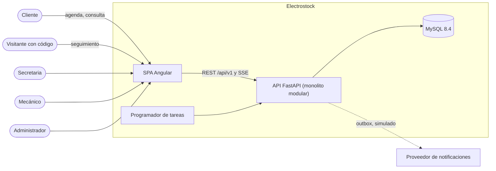

**Interfaces del sistema** (detalle verificable en [[#3.1 Interfaces externas|3.1]]):

| Interfaz | Descripción resumida |
|---|---|
| Usuario | SPA Angular responsive (360 a 1920 px), en español y en inglés, con vistas por rol |
| Hardware | Ninguna directa; el ticket es un PDF de 80 mm imprimible desde el navegador |
| Software | API REST `/api/v1` con contrato OpenAPI 3.1, canal SSE, MySQL 8.4 |
| Comunicaciones | HTTP sobre `127.0.0.1` en local; cookie `HttpOnly` para la renovación de sesión |
| Memoria | Equipo de 8 GB de RAM como referencia de ejecución local |
| Operaciones | Tareas internas cada minuto (expiración, inasistencias, outbox); recordatorios cada 15 minutos |
| Adaptación al sitio | Horario, bahías, IVA y tiempos son parámetros configurables (tabla `settings`) |

### 2.2 Funciones del producto
1. Agendar con verificación y reserva automática de repuestos.
2. Gestionar la capacidad: calendario semaforizado, bloqueos y cola sin cita.
3. Controlar el inventario: stock físico, reservado y disponible; entradas, bajas y alertas.
4. Gestionar la orden de trabajo de *Ingresada* a *Entregada*.
5. Permitir el seguimiento del cliente en tiempo real sin iniciar sesión.
6. Liquidar, cobrar y emitir comprobantes.
7. Reportar y auditar.

La vista general de las funciones por actor es el diagrama **CU-01** (paquetes de casos de uso); el detalle está en [[#3.7.1 Casos de uso|3.7.1]].

### 2.3 Características de los usuarios

| Actor | Tipo | Descripción | Nivel técnico | Dispositivo típico | Frecuencia | Necesidad principal |
|---|---|---|---|---|---|---|
| Cliente | Humano externo | Propietario de vehículos eléctricos; se autorregistra | Bajo a medio | Celular | Ocasional | Agendar con certeza, saber cuándo recoger el vehículo, ver su historial |
| Secretaria (recepción) | Humano interno | Mostrador: clientes, ingresos y pagos | Medio | Computador de mostrador | Diaria, continua | Ver la capacidad del día; registrar llegadas sin desplazar citas |
| Mecánico | Humano interno | Trabaja en bahía con tablet o celular | Medio, con las manos ocupadas | Tablet o celular | Diaria, en ráfagas cortas | Ver sus órdenes, cambiar estados rápido, registrar repuestos instalados |
| Administrador | Humano interno | Responsable del taller | Medio a alto | Computador | Diaria | Inventario, catálogo, usuarios, asignación, reportes, auditoría |
| Programador de tareas | Sistema | Proceso interno asíncrono | - | - | Cada minuto | Expirar bloqueos, marcar inasistencias, liberar reservas, despachar notificaciones |
| Proveedor de notificaciones | Sistema externo (simulado) | Correo y SMS | - | - | Por evento | Recibir mensajes a despachar |

### 2.4 Restricciones
1. **Equipo y plazo:** 3 desarrolladores; entrega lo antes posible.
2. **Tecnología** (detalle en [[#3.5 Restricciones de diseño|3.5]] y [[AR-1-SAD#2. Restricciones de arquitectura|SAD 2]]): frontend Angular; backend Python con FastAPI; MySQL 8.4; Docker Compose local.
3. **Arquitectura frontend exigida por la especificación:** componentes modulares, una carpeta por módulo dentro de `app/` y una carpeta `componentes` con sus archivos ([[#3.5.3 Arquitectura frontend Angular|3.5.3]]).
4. **Normas:** IEEE 830 (este documento), ISO/IEC/IEEE 29148, ISO/IEC 25010 e ISO/IEC/IEEE 29119.
5. **Documentación:** en este vault de Obsidian; diagramas en Figma con respaldo en Mermaid; wireframes y mockups en Figma ([[IS-4-diseno-interfaz]]).
6. **Legales:** tratamiento de datos personales según la Ley 1581 de 2012; el seguimiento público no expone datos personales (RNF-15).
7. **Fase:** sin código; el estado de evidencia de todo requisito es *Diseñado*.

### 2.5 Suposiciones y dependencias

| ID | Supuesto | Impacto si es falso |
|---|---|---|
| SU-01 | Horario de lunes a sábado de 08:00 a 18:00 (America/Bogota); parametrizable | Cambia la generación de franjas |
| SU-02 | 4 bahías; 3 activas en los datos semilla | Cambia la capacidad por franja |
| SU-03 | Cada servicio del catálogo conoce de antemano sus repuestos requeridos | Sin esto no hay reserva al agendar |
| SU-04 | El diagnóstico puede revelar repuestos adicionales, que se reservan en la orden (HU-25) | *Esperando Repuesto* sigue siendo posible, solo por hallazgos nuevos |
| SU-05 | Los integrantes usan Linux, macOS o Windows con Docker | Entorno no reproducible |
| SU-06 | El IVA es parametrizable (valor semilla 19 %) | Cambia la liquidación |

### 2.6 Prorrateo de requisitos
Requisitos que se aplazan a versiones futuras.

**Fuera de alcance de esta fase**

| Elemento | Tratamiento en esta versión | Referencia |
|---|---|---|
| Envío real de correo y SMS | Puerto `Notifier` detrás de un outbox, con adaptador simulado | ADR-15, ADR-36 |
| Facturación electrónica | Comprobante interno en PDF | ADR-15 |
| Impresora térmica ESC/POS | Ticket en PDF de 80 mm | ADR-15 |
| Almacenamiento de fotos del vehículo | No se integra; las pantallas reservan un espacio provisional | ADR-15, [[IS-4-diseno-interfaz]] |
| Pagos en línea | Solo registro manual de pago | ADR-15 |
| Multisede y traslados | Excluido; una sede | ADR-02 |
| Despliegue en la nube | Docker Compose local como *staging* | ADR-13 |
| Aplicación móvil nativa | La web es responsive | - |

**Especificado, implementación posterior al POC:** HU-02, HU-04 (como pantalla propia), HU-08, HU-09, HU-12, HU-13, HU-14, HU-15, HU-16, HU-17, HU-18, HU-20, HU-24, HU-25, HU-27, HU-29 y HU-30. Sus RF están marcados "No" en la columna POC.

---

## 3. Requisitos específicos

### 3.1 Interfaces externas

#### 3.1.1 Interfaces de usuario

| ID | Requisito |
|---|---|
| RIU-01 | La interfaz es una SPA responsive que funciona sin scroll horizontal de 360 a 1920 px (RNF-17). |
| RIU-02 | Cada rol tiene su portal: público, cliente, secretaria, mecánico y administrador. Tras iniciar sesión, el sistema lleva a cada rol a su vista principal. |
| RIU-03 | El panel de bahía usa controles de al menos 44×44 px (56 px de alto en botones de estado) y permite cambiar el estado en 2 toques (RNF-18). |
| RIU-04 | Todo estado se comunica con texto además del color (RNF-19). |
| RIU-05 | La interfaz está en español (es-CO) por defecto y en inglés como segundo idioma (RNF-21). |

Las 26 vistas por rol, sus wireframes, mockups, sistema visual y la matriz de validación con las HU están en [[IS-4-diseno-interfaz]].

#### 3.1.2 Interfaces de hardware
No hay interfaces de hardware directas. El ticket se genera como PDF de 80 mm que el navegador imprime en cualquier impresora; el código QR del ticket se lee con la cámara del celular del cliente.

#### 3.1.3 Interfaces de software

| ID | Requisito |
|---|---|
| RIE-01 | La API expone su contrato en `/api/v1/openapi.json` y la documentación interactiva en `/api/v1/docs` (oculta en producción). |
| RIE-02 | Los errores siguen *Problem Details* (RFC 9457): `type`, `title`, `status`, `detail`, `instance` y `errors[]`. |
| RIE-03 | Los eventos SSE llevan `event:`, `data:` (JSON) e `id:` para reconectar con `Last-Event-ID`. |
| RIE-04 | Montos en pesos colombianos (COP) como enteros; fechas en ISO 8601 con zona horaria. |
| RIE-05 | La base de datos es MySQL 8.4 con motor InnoDB y juego de caracteres utf8mb4 ([[#3.4 Requisitos lógicos de la base de datos|3.4]]). |
| RIE-06 | El envío de notificaciones pasa por el puerto `Notifier`; en esta fase el adaptador es simulado. |

#### 3.1.4 Interfaces de comunicaciones
- HTTP sobre `127.0.0.1` en el entorno local; HTTPS obligatorio fuera del entorno local.
- Cookie `HttpOnly`, `Secure` y `SameSite=Strict` para el token de renovación (RNF-11).
- Canal SSE autenticado con ticket de un solo uso de 60 s, porque `EventSource` no admite cabeceras.

### 3.2 Requisitos funcionales
Los requisitos funcionales se organizan **por módulo funcional** (IEEE 830, plantilla A.4 por característica). Antes de los RF se listan las reglas de negocio que los restringen.

#### 3.2.1 Reglas de negocio
Las reglas de negocio (RN) son restricciones del dominio y **no dependen de la tecnología**. Los valores numéricos son **parámetros configurables**; el valor indicado es el valor por defecto. Su identificador en código está en el diccionario de [[AR-1-SAD#2.4 Diccionario de nombres|SAD 2.4]].

**Agenda y capacidad**

| ID | Regla | Parámetro | Fuente |
|---|---|---|---|
| RN-01 | El taller atiende de lunes a sábado. Las franjas son de 1 hora, de 08:00 a 18:00 (la última inicia a las 17:00), en zona horaria America/Bogota. | `agenda.hora_apertura=08:00`, `agenda.hora_cierre=18:00`, `agenda.dias=LUN-SAB` | ADR-21 |
| RN-02 | La capacidad de una franja es igual al número de bahías activas. Una bahía inactiva no suma capacidad. | `bahia.activa` | ADR-21 |
| RN-03 | La duración del servicio se redondea hacia arriba a horas completas. La cita ocupa ese número de franjas **consecutivas del mismo día**; si no caben antes del cierre, la franja inicial no se ofrece. | `servicio.duracion_min` | ADR-21 |
| RN-04 | Una franja bloqueada manualmente no se ofrece a nuevas citas. Las citas ya confirmadas en ella se conservan y se listan para gestión manual. | - | HU-02 |
| RN-05 | Semáforo por ocupación de la franja: **Verde** < 50 %, **Amarillo** 50 % a < 100 %, **Rojo** = 100 % o bloqueada. | `agenda.umbral_amarillo=0.5` | HU-02 |

**Ciclo de la cita**

| ID | Regla | Parámetro | Fuente |
|---|---|---|---|
| RN-06 | Al iniciar el agendamiento, el sistema crea la cita en estado **En Proceso** y retiene las franjas y los repuestos durante **5 minutos**. | `cita.bloqueo_min=5` | ADR-22 |
| RN-07 | Si el cliente no confirma dentro de los 5 minutos, la cita pasa a **Expirada** y se liberan franjas y repuestos. | `cita.bloqueo_min=5` | ADR-22 |
| RN-08 | Una cita se confirma **solo si** todas sus franjas tienen cupo **y** todos los repuestos requeridos tienen stock disponible. La verificación y la retención son una única transacción atómica. | - | ADR-06, ADR-18 |
| RN-09 | Si la franja elegida está llena, el sistema sugiere la siguiente disponible del mismo día o, si no existe, del siguiente día hábil. | - | HU-01 |
| RN-10 | El cliente solo puede cancelar o reprogramar hasta **1 hora antes** de la hora de inicio. | `cita.ventana_cambio_min=60` | ADR-22 |
| RN-11 | Reprogramar es atómico: se toman las franjas nuevas y se liberan las originales en la misma transacción. Si las nuevas no están disponibles, la cita conserva su horario. Las reservas de repuestos se conservan porque el servicio no cambia. | - | HU-11 |
| RN-12 | Si el vehículo no llega dentro de los **15 minutos** posteriores a la hora de inicio, la cita pasa a **No Asistió** y se liberan franjas y repuestos. | `cita.tolerancia_min=15` | ADR-22 |
| RN-13 | Un cliente no puede tener más de una cita activa (*En Proceso*, *Confirmada* o *Reprogramada*) para el mismo vehículo. | - | Derivada |
| RN-14 | El código de la cita es único y legible: `CITA-AAAAMMDD-NNNN`. | - | HU-01 |

**Inventario**

| ID | Regla | Parámetro | Fuente |
|---|---|---|---|
| RN-15 | Cada repuesto tiene tres cantidades: **stock físico**, **stock reservado** y **disponible = físico - reservado**. | - | ADR-07 |
| RN-16 | Invariantes: físico ≥ 0, reservado ≥ 0, reservado ≤ físico. Ninguna operación puede violarlas. | - | ADR-07 |
| RN-17 | La reserva se crea al **iniciar el agendamiento** (retención temporal de 5 minutos de los repuestos requeridos, que queda firme al confirmar la cita) o al **agregar un repuesto a la orden** (hallazgos del diagnóstico). Ambas aumentan el reservado. | - | HU-19, HU-25 |
| RN-18 | El stock físico se descuenta **solo** al registrar la **instalación**. La instalación reduce el físico y el reservado en la misma cantidad. | - | HU-09 |
| RN-19 | Cancelar, expirar, marcar inasistencia o retirar un repuesto de la orden **libera** la reserva (reduce el reservado). | - | HU-11, HU-28 |
| RN-20 | Una baja de inventario (daño, pérdida, garantía) no puede dejar el físico por debajo del reservado. | - | HU-27 |
| RN-21 | Cuando el disponible cae al umbral mínimo o por debajo, el repuesto queda en **alerta de reabastecimiento**. | `repuesto.umbral_minimo` | HU-08 |
| RN-22 | El SKU es único. Un repuesto con movimientos no se borra; se desactiva. | - | HU-29 |

**Órdenes de trabajo**

| ID | Regla | Fuente |
|---|---|---|
| RN-23 | Un vehículo solo puede tener **una** orden activa (cualquier estado distinto de *Entregada* y *Cancelada*). | HU-23 |
| RN-24 | El número de orden es correlativo y único (`OT-000001`) y se genera de forma atómica. | HU-23 |
| RN-25 | Cada orden tiene un **código de seguimiento público** aleatorio de 10 caracteres, no secuencial y sin caracteres ambiguos. Se guarda como hash y se entrega una sola vez. | HU-07, ADR-33 |
| RN-26 | Al crear la orden desde una cita, la cita pasa a **Atendida** y sus reservas se transfieren a la orden. | HU-23 |
| RN-27 | Las transiciones de estado solo siguen la máquina de [[#3.7.3 Máquinas de estado|3.7.3]] (diagrama DE-02). Cada una registra estado anterior, estado nuevo, usuario y fecha-hora. | HU-05 |
| RN-28 | La orden solo se cancela en *Ingresada* o *Asignada*. Cancelar libera todas sus reservas. | ADR-05 |
| RN-29 | Solo se asignan mecánicos **activos**. El mecánico solo ve y modifica las órdenes asignadas a él. | HU-24 |
| RN-30 | Para pasar a *Finalizada*, la orden no puede tener repuestos en estado *Reservado*: cada uno se marca *Instalado* o se retira. | HU-09 |
| RN-31 | El precio de la mano de obra y de los repuestos se **congela** en la orden al agregarlos. | HU-18 |

**Ingreso sin cita (walk-in) y triage**

| ID | Regla | Fuente |
|---|---|---|
| RN-32 | Un ingreso sin cita **nunca desplaza** una cita confirmada; solo ocupa capacidad libre. | HU-03 |
| RN-33 | Se ubica en la primera franja del día con capacidad libre; si no existe, entra a la **cola de espera** con hora estimada. | HU-03 |
| RN-34 | Todo ingreso sin cita se clasifica por tipo de falla, lo que asigna prioridad **Alta**, **Media** o **Baja** y una duración estimada. | HU-04 |
| RN-35 | La cola se ordena por prioridad y luego por llegada. Las fallas de menos de 15 min pueden intercalarse en huecos breves. | HU-04 |

**Facturación, entrega y encuesta**

| ID | Regla | Parámetro | Fuente |
|---|---|---|---|
| RN-36 | Total = Σ mano de obra + Σ (cantidad × precio unitario) de repuestos **instalados** + IVA sobre el subtotal. | `facturacion.iva=0.19` | HU-13 |
| RN-37 | Solo se liquida una orden *Finalizada*; la liquidación la deja en *Pendiente de Pago*. | - | HU-13 |
| RN-38 | El pago debe ser **exactamente** igual al total; un monto distinto se rechaza mostrando la diferencia. | - | HU-13 |
| RN-39 | No se registra la entrega si la orden no está *Pagada*. | - | HU-13 |
| RN-40 | Una vez emitido, el comprobante es inmutable. | - | HU-13 |
| RN-41 | Cada orden *Entregada* admite **una** encuesta (1 a 5 y comentario) mediante un token único; los duplicados se ignoran. | - | HU-16 |

**Identidad y acceso**

| ID | Regla | Parámetro | Fuente |
|---|---|---|---|
| RN-42 | El correo es único en el sistema. | - | HU-15, HU-21 |
| RN-43 | Contraseña: mínimo 10 caracteres, con al menos una mayúscula, una minúscula, un número y un símbolo. | `seguridad.min_longitud=10` | HU-21 |
| RN-44 | El autorregistro solo crea cuentas **Cliente**; los usuarios internos los crea el Administrador. | - | HU-15, HU-21 |
| RN-45 | Los usuarios no se eliminan; se **desactivan**. Un usuario desactivado no puede iniciar sesión y sus sesiones se revocan. | - | HU-15 |
| RN-46 | Un cliente solo ve sus propios vehículos, citas e historial. | - | HU-30 |
| RN-47 | Si un cliente autorregistrado usa un documento ya registrado por recepción, la cuenta se **vincula** a ese cliente, previa verificación del correo. | - | HU-21, HU-22 |

**Auditoría**

| ID | Regla | Fuente |
|---|---|---|
| RN-48 | La bitácora es *append-only*: nadie, ni el Administrador, puede modificar ni borrar un registro. | HU-20 |
| RN-49 | Se audita todo cambio de estado de citas y órdenes, toda asignación, todo movimiento de inventario y toda gestión de usuarios. | HU-20 |

#### 3.2.2 Módulo Identidad

| ID | Requisito | RN | HU | Prio | Verif. | POC |
|---|---|---|---|---|---|---|
| RF-01 | El sistema debe permitir el autorregistro de clientes con nombres, tipo y número de documento, teléfono, correo y contraseña, y crear la cuenta con rol Cliente. | RN-42, 43, 44, 47 | HU-21 | 1 | P | Sí |
| RF-02 | El sistema debe autenticar usuarios activos con correo y contraseña y entregar un token de acceso y un token de renovación. | RN-45 | HU-21 | 1 | P | Sí |
| RF-03 | El sistema debe renovar la sesión con el token de renovación, rotarlo en cada uso y rechazar tokens revocados o reutilizados. | - | HU-21 | 1 | P | Sí |
| RF-04 | El sistema debe cerrar la sesión revocando el token de renovación. | - | HU-21 | 1 | P | Sí |
| RF-05 | El sistema debe autorizar cada operación según el rol (denegar por defecto) y registrar los intentos no autorizados. | RN-46, RN-29 | HU-10 | 1 | P | Sí (guardias base) |
| RF-06 | El sistema debe permitir al Administrador crear, editar y desactivar usuarios internos con rol obligatorio. | RN-42, RN-45 | HU-15 | 1 | P | No |

Modelos: CU-02, CU-05, DC-01, DS-04.

#### 3.2.3 Módulo Clientes y vehículos

| ID | Requisito | RN | HU | Prio | Verif. | POC |
|---|---|---|---|---|---|---|
| RF-07 | El sistema debe permitir a recepción registrar clientes (con o sin cuenta) validando el formato y la unicidad del documento. | RN-47 | HU-22 | 1 | P | Sí |
| RF-08 | El sistema debe registrar vehículos eléctricos con tipo, número de serie único obligatorio, placa opcional única, marca, modelo, año y especificaciones eléctricas (voltaje nominal, capacidad de batería, tipo de celda, potencia del motor, controlador). | - | HU-22 | 1 | P | Sí |
| RF-09 | El sistema debe buscar vehículos por número de serie, placa o documento del propietario. | - | HU-06 | 2 | P | Sí |
| RF-10 | El sistema debe mostrar el expediente técnico: especificaciones, órdenes anteriores, repuestos instalados y notas técnicas. | - | HU-06 | 2 | P | Sí |
| RF-11 | El sistema debe permitir al mecánico agregar notas técnicas en texto enriquecido, almacenándolas sanitizadas. | - | HU-06 | 2 | P | Sí |
| RF-12 | El sistema debe mostrar al cliente autenticado el historial paginado de órdenes entregadas de sus vehículos. | RN-46 | HU-30 | 2 | P | No |

Modelos: CU-02, CU-03, CU-04, DC-01, DS-05, DS-08.

#### 3.2.4 Módulo Catálogo

| ID | Requisito | RN | HU | Prio | Verif. | POC |
|---|---|---|---|---|---|---|
| RF-13 | El sistema debe permitir crear, editar y desactivar servicios con código, nombre, descripción, precio de mano de obra (> 0) y duración (> 0 min). | RN-31 | HU-18 | 2 | P | No (semilla) |
| RF-14 | El sistema debe permitir definir, por servicio, los repuestos requeridos y sus cantidades. | - | HU-26 | 1 | P | Sí |
| RF-15 | El sistema debe mantener un catálogo de tipos de falla con prioridad y duración estimada. | RN-34 | HU-04 | 2 | P | No (semilla) |

Modelos: CU-05, DC-02.

#### 3.2.5 Módulo Agenda

| ID | Requisito | RN | HU | Prio | Verif. | POC |
|---|---|---|---|---|---|---|
| RF-16 | El sistema debe mostrar, para una fecha y un servicio, las franjas iniciales en las que caben todas las franjas consecutivas requeridas. | RN-01 a RN-04 | HU-01 | 1 | P | Sí |
| RF-17 | El sistema debe retener las franjas y los repuestos durante 5 minutos al iniciar el agendamiento (cita *En Proceso*). | RN-06 | HU-01 | 1 | P | Sí |
| RF-18 | El sistema debe confirmar la cita con un código único y garantizar que dos solicitudes concurrentes no ocupen el mismo cupo. | RN-08, RN-14 | HU-01 | 1 | P | Sí |
| RF-19 | El sistema debe sugerir la siguiente franja disponible cuando la elegida no tiene cupo. | RN-09 | HU-01 | 1 | P | Sí |
| RF-20 | El sistema debe permitir al cliente reprogramar su cita hasta 1 hora antes, de forma atómica. | RN-10, RN-11 | HU-11 | 2 | P | Sí |
| RF-21 | El sistema debe permitir al cliente cancelar su cita hasta 1 hora antes y liberar franjas y repuestos. | RN-10, RN-19 | HU-11 | 2 | P | Sí |
| RF-22 | El sistema debe expirar las citas *En Proceso* vencidas y marcar *No Asistió* las citas sin llegada 15 minutos después de su hora. | RN-07, RN-12 | HU-28 | 1 | P | Sí |
| RF-23 | El sistema debe mostrar a recepción un calendario semaforizado y permitir bloquear y desbloquear franjas con motivo. | RN-04, RN-05 | HU-02 | 1 | P | No |
| RF-24 | El sistema debe registrar ingresos sin cita asignándoles franja libre o posición en cola, sin desplazar citas. | RN-32, RN-33 | HU-03 | 1 | P | Sí |
| RF-25 | El sistema debe exigir el tipo de falla de todo ingreso sin cita y ordenar la cola por prioridad. | RN-34, RN-35 | HU-04 | 2 | P | Sí (dentro de HU-03) |
| RF-26 | El sistema debe enviar un recordatorio 24 horas antes de la cita a través del outbox, con hasta 3 reintentos. | - | HU-12 | 3 | P | No |

Modelos: CU-02, CU-03, CU-05, DC-02, DE-01, DS-01, DS-02, DS-03, DS-05, DA-01, DA-02.

#### 3.2.6 Módulo Inventario

| ID | Requisito | RN | HU | Prio | Verif. | POC |
|---|---|---|---|---|---|---|
| RF-27 | El sistema debe registrar repuestos con SKU único, nombre, categoría, precios, stock inicial, umbral mínimo y voltaje compatible (opcional). | RN-22 | HU-29 | 2 | P | No (semilla) |
| RF-28 | El sistema debe registrar entradas y bajas de inventario con cantidad, motivo y usuario. | RN-20 | HU-27 | 2 | P | No |
| RF-29 | El sistema debe mostrar, por repuesto, el stock físico, reservado y disponible. | RN-15 | HU-08 | 1 | P | Sí (lectura) |
| RF-30 | El sistema debe reservar automáticamente los repuestos requeridos al iniciar el agendamiento y rechazar la cita si alguno no tiene disponible suficiente, indicando cuál. | RN-08, RN-17 | HU-19 | 1 | P | Sí |
| RF-31 | El sistema debe liberar reservas por cancelación, expiración, inasistencia, cancelación de orden o retiro del repuesto. | RN-19 | HU-11, HU-28 | 1 | P | Sí |
| RF-32 | El sistema debe resaltar los repuestos con disponible en el umbral mínimo o por debajo. | RN-21 | HU-08 | 1 | P | No |

Modelos: CU-05, DC-02, DS-01, DS-03.

#### 3.2.7 Módulo Órdenes de trabajo

| ID | Requisito | RN | HU | Prio | Verif. | POC |
|---|---|---|---|---|---|---|
| RF-33 | El sistema debe crear órdenes desde una cita o sin cita, con número correlativo, código de seguimiento y estado *Ingresada*, transfiriendo las reservas de la cita. | RN-23 a RN-26 | HU-23 | 1 | P | Sí |
| RF-34 | El sistema debe permitir al Administrador asignar y reasignar órdenes a mecánicos activos. | RN-29 | HU-24 | 1 | P | No (semilla) |
| RF-35 | El sistema debe aplicar la máquina de estados de la orden y rechazar transiciones no permitidas indicando los estados válidos. | RN-27, RN-28 | HU-05 | 1 | P | Sí |
| RF-36 | El sistema debe permitir al mecánico registrar el diagnóstico. | - | HU-05 | 1 | P | Sí |
| RF-37 | El sistema debe permitir al mecánico agregar repuestos a la orden, reservándolos, con precio congelado. | RN-17, RN-31 | HU-25 | 1 | P | No |
| RF-38 | El sistema debe registrar la instalación de un repuesto, descontando físico y reservado en una transacción. | RN-18, RN-30 | HU-09 | 1 | P | No |
| RF-39 | El sistema debe permitir consultar sin sesión el estado y la línea de tiempo de una orden con su código de seguimiento, sin exponer datos personales ni costos. | RN-25 | HU-07 | 2 | P | Sí |
| RF-40 | El sistema debe publicar por SSE los cambios de órdenes y de la cola al panel de bahía, a recepción y al seguimiento público. | - | HU-05, HU-07 | 1 | P | Sí |

Modelos: CU-03, CU-04, CU-05, DC-03, DE-02, DS-06, DS-07, DA-01.

#### 3.2.8 Módulo Facturación

| ID | Requisito | RN | HU | Prio | Verif. | POC |
|---|---|---|---|---|---|---|
| RF-41 | El sistema debe liquidar órdenes *Finalizadas* (mano de obra, repuestos instalados, IVA) y pasarlas a *Pendiente de Pago*. | RN-36, RN-37 | HU-13 | 1 | P | No |
| RF-42 | El sistema debe registrar el pago por el valor exacto, emitir un comprobante inmutable y pasar la orden a *Pagada*. | RN-38, RN-40 | HU-13 | 1 | P | No |
| RF-43 | El sistema debe generar un ticket PDF de 80 mm con el número de orden y un QR al portal de seguimiento. | - | HU-17 | 3 | P | No |
| RF-44 | El sistema debe registrar la entrega solo si la orden está *Pagada*. | RN-39 | HU-13 | 1 | P | No |
| RF-45 | El sistema debe permitir una única encuesta por orden entregada mediante un token. | RN-41 | HU-16 | 3 | P | No |

Modelos: CU-02, CU-03, DC-03, DE-02.

#### 3.2.9 Módulos Reportes y Auditoría

| ID | Requisito | RN | HU | Prio | Verif. | POC |
|---|---|---|---|---|---|---|
| RF-46 | El sistema debe generar reportes por rango de fechas: ingresos, órdenes, tiempo promedio por estado, ocupación, consumo de repuestos y satisfacción. | - | HU-14 | 2 | P | No |
| RF-47 | El sistema debe registrar en una bitácora *append-only* cada cambio sobre citas, órdenes, inventario y usuarios, con usuario, fecha-hora, valor anterior y nuevo. | RN-48, RN-49 | HU-20 | 2 | P | Parcial (estados de orden) |

Modelos: CU-05, BD-04.

#### 3.2.10 Matriz de permisos por rol (RBAC) y estabilidad

| Operación | Cliente | Secretaria | Mecánico | Administrador |
|---|:---:|:---:|:---:|:---:|
| Autorregistro, login | Sí | Login | Login | Login |
| Agendar, reprogramar, cancelar cita propia | Sí | En nombre del cliente | No | Sí |
| Ver calendario y bloquear franjas | No | Sí | No | Sí |
| Registrar cliente y vehículo | Solo sus vehículos | Sí | No | Sí |
| Registrar ingreso sin cita | No | Sí | No | Sí |
| Crear y cancelar orden | No | Sí | No | Sí |
| Asignar mecánico | No | No | No | Sí |
| Cambiar estado técnico, diagnóstico, repuestos | No | No | Solo órdenes asignadas | No |
| Ver expediente técnico | No | Lectura | Sí | Sí |
| Liquidar, cobrar, entregar | No | Sí | No | Sí |
| Inventario: lectura | No | Sí | Sí | Sí |
| Inventario: entradas, bajas, catálogo | No | No | No | Sí |
| Catálogo de servicios y repuestos requeridos | No | Lectura | Lectura | Sí |
| Usuarios internos | No | No | No | Sí |
| Reportes y auditoría | No | No | No | Sí |
| Seguimiento público por código | Sin sesión | Sin sesión | Sin sesión | Sin sesión |

**Estabilidad por módulo** (IEEE 830, sección 4.3.5: probabilidad de que el requisito cambie)

| Módulo | Estabilidad | Motivo |
|---|---|---|
| Agenda e Inventario | Alta | Son la propuesta de valor; sus reglas están fijadas por ADR-05 a ADR-07 |
| Órdenes de trabajo | Media | La evaluación puede pedir cambios de transición; el patrón State los aísla (QA-10) |
| Identidad | Alta | Sigue prácticas de seguridad estándar |
| Clientes y vehículos | Media | Las fotos del vehículo se incorporarán en una fase posterior |
| Catálogo | Media | Precios y duraciones cambian por parámetro, no por requisito |
| Facturación | Baja | La facturación electrónica puede reemplazar el comprobante interno |
| Reportes y Auditoría | Media | Los indicadores pueden ajustarse a lo que pida el taller |

### 3.3 Requisitos de rendimiento

**Condiciones de medición**, salvo que se indique otra cosa:
- entorno Docker Compose local ([[AR-1-SAD#7. Vista de despliegue|SAD 7]]);
- equipo de 8 GB de RAM, con el hardware registrado en el reporte;
- **volumen de referencia heredado de la línea base v0.2: 5.000 vehículos y 50.000 órdenes históricas**.

**Estado de evidencia:** todos los RNF están en *Diseñado* ([[AR-4-linea-base#4. Práctica adoptada estado de evidencia|práctica adoptada de la v0.2]]). La v0.2 tiene evidencia parcial de RNF-10, 14, 15 y 16, que debe volver a verificarse sobre la v2.

Característica ISO/IEC 25010: **Eficiencia de desempeño**.

| ID | Requisito | Subcaracterística | Métrica y umbral | Verificación |
|---|---|---|---|---|
| RNF-01 | Las lecturas deben responder con rapidez bajo carga normal. | Comportamiento temporal | p95 ≤ 500 ms con 50 usuarios concurrentes; **seguimiento público p95 < 1 s** | JMeter (CP-40) |
| RNF-02 | La búsqueda de vehículo debe ser rápida. | Comportamiento temporal | p95 ≤ 300 ms; máximo 2 s sobre 5.000 vehículos y 50.000 órdenes | JMeter, `EXPLAIN` |
| RNF-03 | El sistema debe soportar ráfagas de reserva sobre un mismo cupo. | Capacidad | 100 solicitudes simultáneas sobre la última plaza: 1 éxito, 99 rechazos `409`, 0 errores `5xx` | JMeter (CP-41) |
| RNF-04 | Los cambios de estado deben llegar casi de inmediato. | Comportamiento temporal | Evento → pantalla ≤ 2 s | Selenium (CP-44) |
| RNF-05 | El frontend debe cargar rápido en celular. | Utilización de recursos | Bundle inicial ≤ 500 kB comprimido; LCP ≤ 2,5 s en Lighthouse móvil | Lighthouse |

**Capacidad estática:** una sede, 4 bahías, hasta 50 usuarios concurrentes y los volúmenes de referencia indicados arriba.

---

### 3.4 Requisitos lógicos de la base de datos
Esta sección es la **fuente autorizada del modelo de datos**. El SAD ([[AR-1-SAD#5.4 Arquitectura de datos y modelo relacional|SAD 5.4]]) la referencia y describe la estrategia de persistencia.

**Requisitos generales de la base de datos**

| ID | Requisito |
|---|---|
| RBD-01 | Motor MySQL 8.4 LTS, almacenamiento InnoDB (transaccional, con bloqueo de filas), juego de caracteres `utf8mb4` y colación `utf8mb4_0900_ai_ci`. |
| RBD-02 | Las claves primarias son UUID versión 7 almacenados en `BINARY(16)`, salvo catálogos de clave natural (`bays`, `settings`, `sequences`). |
| RBD-03 | Todas las fechas se guardan en UTC con `DATETIME(6)` y se presentan en America/Bogota. |
| RBD-04 | Los montos se guardan como enteros en COP (`INT UNSIGNED`), sin decimales. |
| RBD-05 | Las invariantes de negocio críticas se refuerzan en la base con `CHECK`, `UNIQUE` y columnas generadas, además de validarse en el dominio. |
| RBD-06 | Las operaciones de reserva bloquean filas con `SELECT ... FOR UPDATE` en orden fijo: franjas antes que repuestos, y cada grupo ordenado por `id` (ADR-18). |
| RBD-07 | Ningún registro con historia se borra físicamente: usuarios, repuestos y servicios se desactivan. La bitácora solo admite `INSERT` y `SELECT`. |
| RBD-08 | Los cambios de esquema se versionan con migraciones Alembic; nunca se modifican tablas a mano. |
| RBD-09 | Retención: órdenes, comprobantes y bitácora se conservan al menos 5 años; tickets SSE y sesiones vencidas se depuran a los 30 días. |

#### 3.4.1 Modelo conceptual
Diagrama **BD-01** (pata de gallo). Muestra 19 conceptos de negocio y sus relaciones, incluidas las de muchos a muchos tal como existen en el negocio. Las tablas técnicas (sesiones, tickets SSE, secuencias y parámetros) y las relaciones de autoría con Usuario solo aparecen en el modelo lógico.

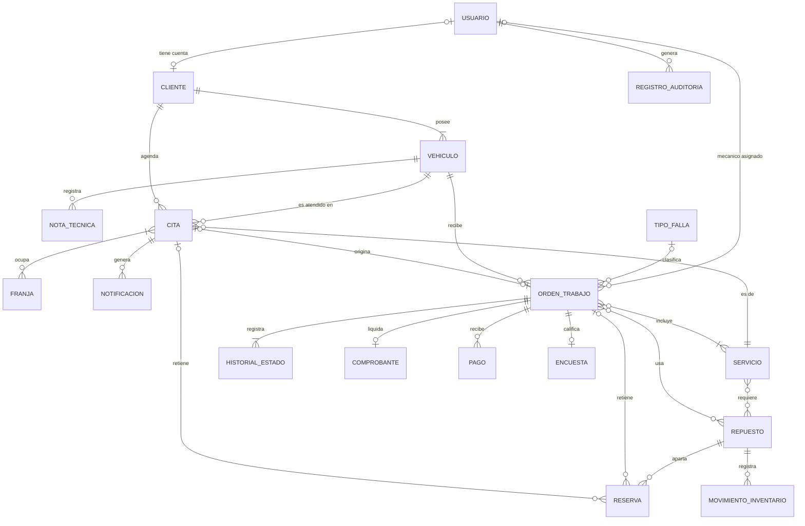

La capacidad de una franja depende de las bahías activas (RN-02); es una dependencia de cálculo, sin clave foránea.

#### 3.4.2 Modelo lógico relacional
Diagramas **BD-02** (identidad, clientes y catálogo), **BD-03** (agenda e inventario) y **BD-04** (órdenes, facturación y auditoría). Las relaciones de muchos a muchos del modelo conceptual se resuelven con tablas asociativas:

| Relación conceptual | Tabla asociativa | Clave primaria |
|---|---|---|
| Cita ocupa Franja | `appointment_slots` | (`appointment_id`, `slot_id`) |
| Servicio requiere Repuesto | `service_parts` | (`service_id`, `part_id`) |
| Orden incluye Servicio | `work_order_services` | (`work_order_id`, `service_id`) |
| Orden usa Repuesto | `work_order_parts` | `id` (una orden puede usar el mismo repuesto en dos líneas) |

**Esquema relacional** (PK subrayada con `PK`, claves foráneas con flecha):

| Tabla | Clave primaria | Claves foráneas | Únicas |
|---|---|---|---|
| `users` | `id` | - | `email` |
| `refresh_sessions` | `id` | `user_id` → users | `token_hash` |
| `sse_tickets` | `ticket_hash` | `user_id` → users | - |
| `customers` | `id` | `user_id` → users | `user_id`; (`document_type`, `document_number`) |
| `vehicles` | `id` | `customer_id` → customers | `serial_number`; `plate` |
| `technical_notes` | `id` | `vehicle_id` → vehicles; `work_order_id` → work_orders; `author_id` → users | - |
| `services` | `id` | - | `code` |
| `service_parts` | (`service_id`, `part_id`) | `service_id` → services; `part_id` → parts | - |
| `fault_types` | `id` | - | `name` |
| `bays` | `id` | - | - |
| `slots` | `id` | - | (`slot_date`, `start_time`) |
| `appointments` | `id` | `customer_id` → customers; `vehicle_id` → vehicles; `service_id` → services | `code` |
| `appointment_slots` | (`appointment_id`, `slot_id`) | `appointment_id` → appointments; `slot_id` → slots | - |
| `notifications` | `id` | `appointment_id` → appointments | `idempotency_key` |
| `parts` | `id` | - | `sku` |
| `part_reservations` | `id` | `part_id` → parts; `appointment_id` → appointments; `work_order_id` → work_orders | - |
| `inventory_movements` | `id` | `part_id` → parts; `user_id` → users | - |
| `work_orders` | `id` | `vehicle_id` → vehicles; `appointment_id` → appointments; `fault_type_id` → fault_types; `mechanic_id` → users | `number`; `tracking_code_hash`; `appointment_id`; `active_vehicle_id` |
| `work_order_status_history` | `id` | `work_order_id` → work_orders; `user_id` → users | - |
| `work_order_services` | (`work_order_id`, `service_id`) | `work_order_id` → work_orders; `service_id` → services | - |
| `work_order_parts` | `id` | `work_order_id` → work_orders; `part_id` → parts; `reservation_id` → part_reservations | `reservation_id` |
| `sequences` | `name` | - | - |
| `receipts` | `id` | `work_order_id` → work_orders | `work_order_id`; `number` |
| `payments` | `id` | `work_order_id` → work_orders | `idempotency_key` |
| `surveys` | `id` | `work_order_id` → work_orders | `work_order_id`; `token_hash` |
| `audit_log` | `id` | `user_id` → users | - |
| `settings` | `key` | - | - |

**Uso en el POC:** 20 de las 27 tablas se crean y usan en el POC (`users`, `refresh_sessions`, `sse_tickets`, `customers`, `vehicles`, `technical_notes`, `services`, `service_parts`, `fault_types`, `bays`, `slots`, `appointments`, `appointment_slots`, `parts`, `part_reservations`, `work_orders`, `work_order_status_history`, `sequences`, `audit_log`, `settings`). Las otras 7 se crean vacías por migración.

#### 3.4.3 Diccionario de datos
Nombres de tabla, columna y valores de enumerado en inglés (ADR-38), iguales a los del diccionario normativo de [[AR-1-SAD#2.4 Diccionario de nombres|SAD 2.4]]; el concepto en español está en la segunda columna. Las columnas `created_at` y `updated_at` son `DATETIME(6) NOT NULL`, en UTC, y no se repiten en cada tabla salvo cuando tienen una regla propia.

**`users`: Usuario**

| Columna | Concepto | Tipo | Nulo | Clave | Regla o valor por defecto |
|---|---|---|---|---|---|
| `id` | Identificador | BINARY(16) | No | PK | UUID v7 |
| `full_name` | Nombres completos | VARCHAR(120) | No | | 2 a 120 caracteres |
| `email` | Correo | VARCHAR(160) | No | UQ | En minúsculas (RN-42) |
| `password_hash` | Hash de la contraseña | VARCHAR(255) | No | | Argon2id (RNF-10) |
| `role` | Rol | ENUM('CUSTOMER','RECEPTIONIST','MECHANIC','ADMIN') | No | | |
| `active` | Activo | BOOLEAN | No | | TRUE (RN-45) |
| `must_change_password` | Debe cambiar contraseña | BOOLEAN | No | | FALSE; TRUE para usuarios internos nuevos |
| `created_at`, `updated_at` | Auditoría de registro | DATETIME(6) | No | | |

**`refresh_sessions`: Sesión de renovación**

| Columna | Concepto | Tipo | Nulo | Clave | Regla o valor por defecto |
|---|---|---|---|---|---|
| `id` | Identificador | BINARY(16) | No | PK | |
| `user_id` | Usuario | BINARY(16) | No | FK | ON DELETE RESTRICT |
| `family_id` | Familia de rotación | BINARY(16) | No | | Se revoca completa si se reutiliza un token (RF-03) |
| `token_hash` | Hash del token | CHAR(64) | No | UQ | SHA-256 |
| `expires_at` | Vence en | DATETIME(6) | No | | Creación + 8 h |
| `revoked_at` | Revocada en | DATETIME(6) | Sí | | |
| `created_at` | Creada en | DATETIME(6) | No | | |

**`sse_tickets`: Ticket de canal SSE**

| Columna | Concepto | Tipo | Nulo | Clave | Regla o valor por defecto |
|---|---|---|---|---|---|
| `ticket_hash` | Hash del ticket | CHAR(64) | No | PK | |
| `user_id` | Usuario | BINARY(16) | No | FK | |
| `expires_at` | Vence en | DATETIME(6) | No | | Creación + 60 s |
| `used_at` | Usado en | DATETIME(6) | Sí | | Un solo uso |

**`customers`: Cliente**

| Columna | Concepto | Tipo | Nulo | Clave | Regla o valor por defecto |
|---|---|---|---|---|---|
| `id` | Identificador | BINARY(16) | No | PK | |
| `user_id` | Cuenta del cliente | BINARY(16) | Sí | FK, UQ | Nulo si lo registró recepción sin cuenta (RN-47) |
| `document_type` | Tipo de documento | ENUM('CC','CE','PA') | No | UQ compuesta | |
| `document_number` | Número de documento | VARCHAR(12) | No | UQ compuesta | CC 6-10 dígitos; CE y PA 6-12 alfanuméricos |
| `full_name` | Nombres completos | VARCHAR(120) | No | | |
| `phone` | Teléfono | VARCHAR(20) | No | | |
| `email` | Correo de contacto | VARCHAR(160) | Sí | | |
| `created_at`, `updated_at` | Auditoría de registro | DATETIME(6) | No | | |

**`vehicles`: Vehículo**

| Columna | Concepto | Tipo | Nulo | Clave | Regla o valor por defecto |
|---|---|---|---|---|---|
| `id` | Identificador | BINARY(16) | No | PK | |
| `customer_id` | Propietario | BINARY(16) | No | FK | |
| `type` | Tipo de vehículo | ENUM('E_BIKE','SCOOTER','SKATEBOARD','MOTORCYCLE','MONOWHEEL','MICROCAR','QUADRICYCLE') | No | | |
| `serial_number` | Número de serie | VARCHAR(30) | No | UQ | `^[A-Z0-9-]{5,30}$` |
| `plate` | Placa | VARCHAR(7) | Sí | UQ | Formato de moto o de carro |
| `brand` | Marca | VARCHAR(60) | No | | |
| `model` | Modelo | VARCHAR(60) | No | | |
| `year` | Año | SMALLINT | Sí | | CHECK 2000 a año actual + 1 |
| `nominal_voltage_v` | Voltaje nominal | SMALLINT | No | | CHECK > 0 |
| `battery_capacity_ah` | Capacidad de batería | DECIMAL(6,2) | Sí | | CHECK > 0 |
| `cell_type` | Tipo de celda | VARCHAR(40) | Sí | | |
| `motor_power_w` | Potencia del motor | INT | Sí | | CHECK > 0 |
| `controller` | Controlador | VARCHAR(60) | Sí | | |
| `created_at`, `updated_at` | Auditoría de registro | DATETIME(6) | No | | |

**`technical_notes`: Nota técnica**

| Columna | Concepto | Tipo | Nulo | Clave | Regla o valor por defecto |
|---|---|---|---|---|---|
| `id` | Identificador | BINARY(16) | No | PK | |
| `vehicle_id` | Vehículo | BINARY(16) | No | FK | |
| `work_order_id` | Orden relacionada | BINARY(16) | Sí | FK | |
| `author_id` | Autor | BINARY(16) | No | FK | Usuario mecánico o administrador |
| `content_html` | Contenido | TEXT | No | | HTML sanitizado con lista blanca (RNF-14) |
| `created_at` | Creada en | DATETIME(6) | No | | Inmutable |

**`services`: Servicio**

| Columna | Concepto | Tipo | Nulo | Clave | Regla o valor por defecto |
|---|---|---|---|---|---|
| `id` | Identificador | BINARY(16) | No | PK | |
| `code` | Código | VARCHAR(20) | No | UQ | |
| `name` | Nombre | VARCHAR(120) | No | | |
| `description` | Descripción | VARCHAR(500) | Sí | | |
| `labor_price` | Precio de mano de obra | INT UNSIGNED | No | | CHECK > 0 |
| `duration_min` | Duración | SMALLINT UNSIGNED | No | | CHECK > 0 (RN-03) |
| `active` | Activo | BOOLEAN | No | | TRUE |
| `created_at`, `updated_at` | Auditoría de registro | DATETIME(6) | No | | |

**`service_parts`: Repuesto requerido por servicio**

| Columna | Concepto | Tipo | Nulo | Clave | Regla o valor por defecto |
|---|---|---|---|---|---|
| `service_id` | Servicio | BINARY(16) | No | PK, FK | |
| `part_id` | Repuesto | BINARY(16) | No | PK, FK | |
| `quantity` | Cantidad | SMALLINT UNSIGNED | No | | CHECK > 0 |

**`fault_types`: Tipo de falla**

| Columna | Concepto | Tipo | Nulo | Clave | Regla o valor por defecto |
|---|---|---|---|---|---|
| `id` | Identificador | BINARY(16) | No | PK | |
| `name` | Nombre | VARCHAR(80) | No | UQ | |
| `priority` | Prioridad | ENUM('HIGH','MEDIUM','LOW') | No | | RN-34 |
| `estimated_minutes` | Duración estimada | SMALLINT | No | | CHECK > 0 |
| `active` | Activo | BOOLEAN | No | | TRUE |

**`bays`: Bahía**

| Columna | Concepto | Tipo | Nulo | Clave | Regla o valor por defecto |
|---|---|---|---|---|---|
| `id` | Código de bahía | VARCHAR(10) | No | PK | B1, B2, B3, B4 |
| `name` | Nombre | VARCHAR(40) | No | | |
| `active` | Activa | BOOLEAN | No | | Suma capacidad solo si está activa (RN-02) |

**`slots`: Franja**

| Columna | Concepto | Tipo | Nulo | Clave | Regla o valor por defecto |
|---|---|---|---|---|---|
| `id` | Identificador | BINARY(16) | No | PK | |
| `slot_date` | Fecha | DATE | No | UQ compuesta | Lunes a sábado (RN-01) |
| `start_time` | Hora de inicio | TIME | No | UQ compuesta | 08:00 a 17:00 |
| `capacity` | Capacidad | TINYINT UNSIGNED | No | | Bahías activas al generarla |
| `booked_count` | Ocupados | TINYINT UNSIGNED | No | | 0; CHECK `booked_count <= capacity` |
| `blocked` | Bloqueada | BOOLEAN | No | | FALSE (RN-04) |
| `block_reason` | Motivo de bloqueo | VARCHAR(200) | Sí | | Obligatorio si `blocked` |

**`appointments`: Cita**

| Columna | Concepto | Tipo | Nulo | Clave | Regla o valor por defecto |
|---|---|---|---|---|---|
| `id` | Identificador | BINARY(16) | No | PK | |
| `code` | Código de la cita | VARCHAR(20) | No | UQ | `CITA-AAAAMMDD-NNNN` (RN-14) |
| `customer_id` | Cliente | BINARY(16) | No | FK | |
| `vehicle_id` | Vehículo | BINARY(16) | No | FK | |
| `service_id` | Servicio | BINARY(16) | No | FK | |
| `status` | Estado | ENUM('HELD','CONFIRMED','RESCHEDULED','CANCELLED','NO_SHOW','ATTENDED','EXPIRED') | No | | DE-01; `HELD` = En Proceso (diccionario de [[AR-1-SAD#2.4 Diccionario de nombres\|SAD 2.4]]) |
| `starts_at` | Hora de inicio | DATETIME(6) | No | | |
| `hold_expires_at` | Vence el bloqueo | DATETIME(6) | Sí | | Creación + 5 min (RN-06) |
| `cancel_reason` | Motivo de cancelación | VARCHAR(200) | Sí | | |
| `version` | Versión | INT | No | | 0; bloqueo optimista |
| `created_at`, `updated_at` | Auditoría de registro | DATETIME(6) | No | | |

**`appointment_slots`: Franjas de la cita**

| Columna | Concepto | Tipo | Nulo | Clave | Regla o valor por defecto |
|---|---|---|---|---|---|
| `appointment_id` | Cita | BINARY(16) | No | PK, FK | |
| `slot_id` | Franja | BINARY(16) | No | PK, FK | Franjas consecutivas del mismo día (RN-03) |

**`notifications`: Notificación (outbox)**

| Columna | Concepto | Tipo | Nulo | Clave | Regla o valor por defecto |
|---|---|---|---|---|---|
| `id` | Identificador | BINARY(16) | No | PK | |
| `appointment_id` | Cita | BINARY(16) | Sí | FK | |
| `channel` | Canal | ENUM('EMAIL','SMS') | No | | |
| `recipient` | Destinatario | VARCHAR(160) | No | | |
| `payload` | Contenido | JSON | No | | |
| `status` | Estado | ENUM('PENDING','SENT','UNDELIVERED') | No | | PENDING |
| `attempts` | Intentos | TINYINT | No | | 0; máximo 3 (RF-26) |
| `next_attempt_at` | Próximo intento | DATETIME(6) | Sí | | |
| `idempotency_key` | Clave de idempotencia | VARCHAR(80) | No | UQ | Evita envíos duplicados |
| `created_at` | Creada en | DATETIME(6) | No | | |
| `sent_at` | Enviada en | DATETIME(6) | Sí | | |

**`parts`: Repuesto**

| Columna | Concepto | Tipo | Nulo | Clave | Regla o valor por defecto |
|---|---|---|---|---|---|
| `id` | Identificador | BINARY(16) | No | PK | |
| `sku` | SKU | VARCHAR(30) | No | UQ | `^[A-Z0-9-]{3,30}$` (RN-22) |
| `name` | Nombre | VARCHAR(120) | No | | |
| `category` | Categoría | ENUM('BATTERY','CONTROLLER','MOTOR','CHARGER','BRAKES','WHEELS','CONTROLS','OTHER') | No | | La tarjeta BMS se registra como `BATTERY` |
| `purchase_price` | Precio de compra | INT UNSIGNED | No | | |
| `sale_price` | Precio de venta | INT UNSIGNED | No | | CHECK > 0 |
| `physical_stock` | Stock físico | INT | No | | CHECK ≥ 0 (RN-16) |
| `reserved_stock` | Stock reservado | INT | No | | 0; CHECK ≥ 0 y ≤ `physical_stock` (RN-16) |
| `min_threshold` | Umbral mínimo | INT | No | | CHECK ≥ 0 (RN-21) |
| `compatible_voltage_v` | Voltaje compatible | SMALLINT UNSIGNED | Sí | | Usado por RNF-29 |
| `active` | Activo | BOOLEAN | No | | TRUE |
| `created_at`, `updated_at` | Auditoría de registro | DATETIME(6) | No | | |

El disponible (`physical_stock - reserved_stock`) **no se almacena**: se calcula, para que nunca quede desactualizado (tercera forma normal).

**`part_reservations`: Reserva de repuesto**

| Columna | Concepto | Tipo | Nulo | Clave | Regla o valor por defecto |
|---|---|---|---|---|---|
| `id` | Identificador | BINARY(16) | No | PK | |
| `part_id` | Repuesto | BINARY(16) | No | FK | |
| `appointment_id` | Cita | BINARY(16) | Sí | FK | |
| `work_order_id` | Orden | BINARY(16) | Sí | FK | CHECK: al menos uno de `appointment_id` o `work_order_id` |
| `quantity` | Cantidad | INT UNSIGNED | No | | CHECK > 0 |
| `status` | Estado | ENUM('ACTIVE','CONSUMED','RELEASED','EXPIRED') | No | | ACTIVE |
| `expires_at` | Vence en | DATETIME(6) | Sí | | 5 min en *En Proceso*; hora + 15 min al confirmar |
| `created_at` | Creada en | DATETIME(6) | No | | |

**`inventory_movements`: Movimiento de inventario**

| Columna | Concepto | Tipo | Nulo | Clave | Regla o valor por defecto |
|---|---|---|---|---|---|
| `id` | Identificador | BINARY(16) | No | PK | |
| `part_id` | Repuesto | BINARY(16) | No | FK | |
| `type` | Tipo | ENUM('IN','WRITE_OFF','CONSUMPTION','ADJUSTMENT') | No | | |
| `quantity` | Cantidad | INT | No | | CHECK ≠ 0 |
| `reason` | Motivo | VARCHAR(200) | Sí | | Obligatorio en bajas (RN-20) |
| `reference_id` | Referencia | BINARY(16) | Sí | | Orden o reserva que origina el movimiento |
| `user_id` | Usuario | BINARY(16) | No | FK | |
| `created_at` | Registrado en | DATETIME(6) | No | | Inmutable |

**`work_orders`: Orden de trabajo**

| Columna | Concepto | Tipo | Nulo | Clave | Regla o valor por defecto |
|---|---|---|---|---|---|
| `id` | Identificador | BINARY(16) | No | PK | |
| `number` | Número | VARCHAR(12) | No | UQ | `OT-000001` (RN-24) |
| `tracking_code_hash` | Hash del código de seguimiento | CHAR(64) | No | UQ | RN-25 |
| `vehicle_id` | Vehículo | BINARY(16) | No | FK | |
| `appointment_id` | Cita de origen | BINARY(16) | Sí | FK, UQ | Nulo si es ingreso sin cita |
| `origin` | Origen | ENUM('APPOINTMENT','WALK_IN') | No | | |
| `fault_type_id` | Tipo de falla | BINARY(16) | Sí | FK | Obligatorio si `origin = WALK_IN` (RN-34) |
| `priority` | Prioridad | ENUM('HIGH','MEDIUM','LOW') | Sí | | |
| `mechanic_id` | Mecánico asignado | BINARY(16) | Sí | FK | Usuario con rol MECHANIC activo (RN-29) |
| `status` | Estado | ENUM('RECEIVED','ASSIGNED','DIAGNOSING','WAITING_PARTS','REPAIRING','FINISHED','PENDING_PAYMENT','PAID','DELIVERED','CANCELLED') | No | | RECEIVED; DE-02 |
| `active_vehicle_id` | Vehículo con orden activa | BINARY(16) | Sí | UQ | Columna generada: `vehicle_id` si el estado no es DELIVERED ni CANCELLED (RN-23) |
| `intake_reason` | Motivo de ingreso | VARCHAR(500) | No | | |
| `reported_faults` | Fallas reportadas | VARCHAR(500) | Sí | | |
| `mileage_km` | Kilometraje | INT | Sí | | CHECK ≥ 0 |
| `diagnosis` | Diagnóstico | TEXT | Sí | | |
| `queue_position` | Posición en cola | INT | Sí | | Solo ingresos sin cita sin franja (RN-33) |
| `estimated_delivery_at` | Entrega estimada | DATETIME(6) | Sí | | |
| `finished_at` | Finalizada en | DATETIME(6) | Sí | | |
| `delivered_at` | Entregada en | DATETIME(6) | Sí | | |
| `version` | Versión | INT | No | | 0; bloqueo optimista |
| `created_at`, `updated_at` | Auditoría de registro | DATETIME(6) | No | | |

**`work_order_status_history`: Historial de estado**

| Columna | Concepto | Tipo | Nulo | Clave | Regla o valor por defecto |
|---|---|---|---|---|---|
| `id` | Identificador | BINARY(16) | No | PK | |
| `work_order_id` | Orden | BINARY(16) | No | FK | |
| `from_status` | Estado anterior | ENUM (10 estados) | Sí | | Nulo en la creación |
| `to_status` | Estado nuevo | ENUM (10 estados) | No | | |
| `user_id` | Usuario | BINARY(16) | No | FK | |
| `correlation_id` | Identificador de correlación | CHAR(36) | Sí | | |
| `created_at` | Fecha | DATETIME(6) | No | | Inmutable |

**`work_order_services`: Servicios de la orden**

| Columna | Concepto | Tipo | Nulo | Clave | Regla o valor por defecto |
|---|---|---|---|---|---|
| `work_order_id` | Orden | BINARY(16) | No | PK, FK | |
| `service_id` | Servicio | BINARY(16) | No | PK, FK | |
| `applied_price` | Precio aplicado | INT UNSIGNED | No | | Congelado al agregar (RN-31) |

**`work_order_parts`: Repuestos de la orden**

| Columna | Concepto | Tipo | Nulo | Clave | Regla o valor por defecto |
|---|---|---|---|---|---|
| `id` | Identificador | BINARY(16) | No | PK | |
| `work_order_id` | Orden | BINARY(16) | No | FK | |
| `part_id` | Repuesto | BINARY(16) | No | FK | |
| `reservation_id` | Reserva | BINARY(16) | Sí | FK, UQ | |
| `quantity` | Cantidad | SMALLINT UNSIGNED | No | | CHECK > 0 |
| `unit_price` | Precio unitario | INT UNSIGNED | No | | Congelado al agregar (RN-31) |
| `status` | Estado de la línea | ENUM('RESERVED','INSTALLED','RETURNED') | No | | RESERVED (RN-30) |
| `installed_at` | Instalado en | DATETIME(6) | Sí | | |

**`sequences`: Secuencia de numeración**

| Columna | Concepto | Tipo | Nulo | Clave | Regla o valor por defecto |
|---|---|---|---|---|---|
| `name` | Nombre | VARCHAR(10) | No | PK | `WO` (órdenes), `RCP` (comprobantes) |
| `value` | Último valor | BIGINT UNSIGNED | No | | Se incrementa con `FOR UPDATE` (RN-24) |

**`receipts`: Comprobante**

| Columna | Concepto | Tipo | Nulo | Clave | Regla o valor por defecto |
|---|---|---|---|---|---|
| `id` | Identificador | BINARY(16) | No | PK | |
| `work_order_id` | Orden | BINARY(16) | No | FK, UQ | Un comprobante por orden |
| `number` | Número | VARCHAR(12) | No | UQ | `CMP-000001` |
| `subtotal` | Subtotal | INT UNSIGNED | No | | RN-36 |
| `vat` | IVA | INT UNSIGNED | No | | `settings` facturacion.iva |
| `total` | Total | INT UNSIGNED | No | | CHECK `total = subtotal + vat` |
| `issued_at` | Emitido en | DATETIME(6) | No | | Inmutable (RN-40) |

**`payments`: Pago**

| Columna | Concepto | Tipo | Nulo | Clave | Regla o valor por defecto |
|---|---|---|---|---|---|
| `id` | Identificador | BINARY(16) | No | PK | |
| `work_order_id` | Orden | BINARY(16) | No | FK | |
| `amount` | Monto | INT UNSIGNED | No | | Igual al total (RN-38) |
| `method` | Método | ENUM('CASH','CARD','TRANSFER') | No | | |
| `idempotency_key` | Clave de idempotencia | VARCHAR(80) | No | UQ | Evita pagos duplicados |
| `created_at` | Registrado en | DATETIME(6) | No | | |

**`surveys`: Encuesta**

| Columna | Concepto | Tipo | Nulo | Clave | Regla o valor por defecto |
|---|---|---|---|---|---|
| `id` | Identificador | BINARY(16) | No | PK | |
| `work_order_id` | Orden | BINARY(16) | No | FK, UQ | Una por orden (RN-41) |
| `token_hash` | Hash del token | CHAR(64) | No | UQ | |
| `score` | Puntuación | TINYINT | Sí | | CHECK 1 a 5 |
| `comment` | Comentario | VARCHAR(500) | Sí | | |
| `answered_at` | Respondida en | DATETIME(6) | Sí | | |
| `created_at` | Creada en | DATETIME(6) | No | | |

**`audit_log`: Registro de auditoría**

| Columna | Concepto | Tipo | Nulo | Clave | Regla o valor por defecto |
|---|---|---|---|---|---|
| `id` | Identificador | BINARY(16) | No | PK | |
| `entity` | Entidad | VARCHAR(40) | No | | Cita, orden, repuesto, usuario |
| `entity_id` | Identificador de la entidad | BINARY(16) | No | | |
| `action` | Acción | VARCHAR(40) | No | | |
| `user_id` | Usuario | BINARY(16) | Sí | FK | Nulo si la acción la hace el programador de tareas |
| `old_value` | Valor anterior | JSON | Sí | | |
| `new_value` | Valor nuevo | JSON | Sí | | |
| `correlation_id` | Identificador de correlación | CHAR(36) | No | | |
| `created_at` | Registrado en | DATETIME(6) | No | | Inmutable; triggers rechazan UPDATE y DELETE (RN-48) |

**`settings`: Parámetro de negocio**

| Columna | Concepto | Tipo | Nulo | Clave | Regla o valor por defecto |
|---|---|---|---|---|---|
| `key` | Clave | VARCHAR(60) | No | PK | Por ejemplo `cita.bloqueo_min` |
| `value` | Valor | VARCHAR(200) | No | | |
| `type` | Tipo de dato | ENUM('INT','DECIMAL','TIME','STRING','LIST') | No | | |
| `updated_at` | Actualizado en | DATETIME(6) | No | | |

#### 3.4.4 Normalización
El modelo está en **tercera forma normal (3FN)**:

| Forma normal | Cómo se cumple |
|---|---|
| 1FN | Todas las columnas son atómicas. Las listas (franjas de una cita, repuestos de un servicio) son tablas asociativas, no columnas con varios valores. |
| 2FN | Las tablas con clave compuesta (`appointment_slots`, `service_parts`, `work_order_services`) solo tienen atributos que dependen de la clave completa (`quantity`, `applied_price`). |
| 3FN | No hay dependencias transitivas: el disponible no se guarda (se calcula), el total de la orden vive en `receipts` y los datos del cliente no se copian en la cita ni en la orden. |

**Desnormalizaciones controladas**

| Columna | Por qué se guarda | Cómo se mantiene consistente |
|---|---|---|
| `slots.booked_count` | Contar citas en cada consulta de disponibilidad haría lenta la agenda (RNF-01) | Se actualiza en la misma transacción que la cita; CHECK `booked_count <= capacity` |
| `parts.reserved_stock` | Sumar reservas activas en cada agendamiento bloquearía más filas | Se actualiza en la misma transacción que la reserva; CHECK de RN-16 |
| `work_order_services.applied_price` y `work_order_parts.unit_price` | El precio debe congelarse (RN-31) | Solo se escribe al agregar la línea |
| `work_orders.active_vehicle_id` | Garantizar RN-23 en la base | Columna generada: no se escribe a mano |

#### 3.4.5 Índices

| Tabla | Índice | Consulta que acelera |
|---|---|---|
| `slots` | UQ (`slot_date`, `start_time`) | Disponibilidad de un día (RF-16) |
| `appointments` | (`status`, `hold_expires_at`) | Expiración de bloqueos (RF-22) |
| `appointments` | (`status`, `starts_at`) | Inasistencias y citas del día |
| `appointments` | (`vehicle_id`, `status`) | RN-13 |
| `part_reservations` | (`appointment_id`, `status`), (`work_order_id`, `status`) | Liberación y transferencia de reservas |
| `work_orders` | (`mechanic_id`, `status`) | Panel de bahía (RF-35) |
| `work_orders` | (`status`, `created_at`) | Cola y reportes |
| `vehicles` | UQ `serial_number`, UQ `plate`; `customer_id` | Búsqueda de vehículo (RNF-02) |
| `customers` | UQ (`document_type`, `document_number`) | Búsqueda por documento |
| `notifications` | (`status`, `created_at`) | Despacho del outbox |
| `audit_log` | (`entity`, `entity_id`, `created_at`) | Bitácora de una orden (HU-20) |

#### 3.4.6 Integridad y transacciones
- **Integridad referencial:** todas las claves foráneas usan `ON DELETE RESTRICT`; nada se borra en cascada porque los registros con historia no se borran (RBD-07).
- **Reserva atómica:** agendar abre una transacción, bloquea las franjas y los repuestos en orden fijo, verifica y escribe todo o nada (DS-01, RN-08).
- **Concurrencia de la orden:** bloqueo optimista por `version`; una actualización con versión vieja responde `409` (DS-07).
- **Tareas programadas:** `FOR UPDATE SKIP LOCKED` en lotes de 100, para no competir con una confirmación en curso (DS-03).
- **Idempotencia:** pagos, ingresos sin cita y notificaciones usan una clave de idempotencia única.

---

### 3.5 Restricciones de diseño

#### 3.5.1 Cumplimiento de normas
- Este documento sigue IEEE 830-1998; la correspondencia con ISO/IEC/IEEE 29148 está en el [[#Apéndice C. Correspondencia con ISO 29148 y con la versión anterior|Apéndice C]].
- Requisitos no funcionales clasificados con ISO/IEC 25010:2023 ([[#3.6 Atributos del sistema de software|3.6]]).
- Pruebas según ISO/IEC/IEEE 29119 ([[IS-5-pruebas]]).
- Modelos en UML 2.5.1 y modelo de datos en notación pata de gallo.
- Accesibilidad WCAG 2.2 AA; datos personales según la Ley 1581 de 2012.

#### 3.5.2 Restricciones tecnológicas

| Restricción | Decisión | Referencia |
|---|---|---|
| Frontend | Angular (componentes standalone) | ADR-14, ADR-17 |
| Backend | Python con FastAPI, monolito modular por módulos de dominio | ADR-03, ADR-10 |
| Base de datos | MySQL 8.4 | ADR-09 |
| Despliegue | Docker Compose local | ADR-13 |
| Contrato | OpenAPI 3.1 y SSE | ADR-19 |
| Diagramas | Figma (visual) y Mermaid (respaldo en el vault) | ADR-27, ADR-28 |
| Nombres | Carpetas del frontend en español; código y base de datos en inglés | ADR-38 |

Detalle completo en [[AR-1-SAD#2. Restricciones de arquitectura|SAD 2]].

#### 3.5.3 Arquitectura frontend Angular
El frontend es una **SPA Angular separada del backend**. Se integra solo por la API REST `/api/v1` (contrato OpenAPI) y el canal SSE. Su organización **replica los nueve módulos del backend**, de modo que una HU se ubica en ambos lados (ADR-14, ADR-17). La línea base v0.2 no tiene Angular (usa HTML estático); la rama de Carlos contiene un frontend Angular previo que se debe evaluar como punto de partida ([[AR-4-linea-base]]). Esta sección es el bosquejo que guía esa construcción; no contiene código.

**Principios**
1. **Componentes standalone** en la versión estable vigente de Angular. Sin `NgModule` de funcionalidades.
2. **Un módulo funcional = una carpeta** en `app/`, nombrada en español como exige la especificación (`agenda/`, `ordenes/`, `clientes-vehiculos/`...). Su equivalente en el backend está en el diccionario de [[AR-1-SAD#2.4 Diccionario de nombres|SAD 2.4]].
3. Cada componente vive en su carpeta dentro de `componentes/`, con `.ts`, `.html`, `.css` y `.spec.ts`. **No hay `.js` sueltos**: Angular compila TypeScript y un `.js` paralelo se desincroniza (ADR-31).
4. **Componentes de página** (*smart*) frente a **componentes de presentación** (*dumb*): las páginas inyectan servicios y manejan estado; los de presentación solo reciben entradas y emiten salidas, así sus pruebas no necesitan HTTP.
5. **Estado local con *signals***. Los servicios de cada módulo exponen *signals* de solo lectura y métodos de comando. No hay librería de estado global: una sede no la justifica.
6. **Rutas con carga diferida por módulo** y **guardias por rol**.
7. **Contrato tipado**: los tipos de `modelos/` se generan desde el OpenAPI (`openapi-typescript`), por eso llevan los nombres en inglés del backend.
8. **Convención de nombres (ADR-38):** carpetas de módulo y de componentes en español; clases, servicios, *signals* y tipos en inglés. Los nombres de archivo de `core/` del árbol son ilustrativos; el nombre final sigue el diccionario.
9. **Internacionalización:** todos los textos visibles se externalizan en `assets/i18n/`, con español (es-CO) predeterminado e inglés como segundo idioma, y selector de idioma en la barra superior. Fechas y moneda siguen el formato colombiano en ambos idiomas (RNF-21).

**Estructura de carpetas**

```text
frontend/src/app/
├── app.config.ts                 # providers: router, http con interceptores, locale es-CO, i18n
├── app.routes.ts                 # rutas raíz con carga diferida por módulo
├── app.ts | app.html | app.css   # shell: barra superior + router-outlet
├── core/                         # singletons transversales (sin pantallas de negocio)
│   ├── auth/
│   │   ├── sesion.service.ts           # access token en memoria (signal), refresh por cookie
│   │   ├── auth.interceptor.ts         # agrega Bearer; ante 401 intenta refresh una vez
│   │   ├── rol.guard.ts                # canMatch por rol
│   │   └── sesion.service.spec.ts
│   ├── http/
│   │   ├── error.interceptor.ts        # Problem Details -> mensaje de usuario
│   │   ├── correlacion.interceptor.ts  # X-Correlation-Id
│   │   └── mock.interceptor.ts         # modo demostración con fixtures JSON
│   ├── eventos/
│   │   └── sse.service.ts              # EventSource tipado + reconexión con Last-Event-ID
│   └── config/
│       └── entorno.ts                  # apiUrl, modoMock (desde environment)
├── compartido/                   # presentación reutilizable sin lógica de negocio
│   └── componentes/
│       ├── boton/  ├── campo-texto/  ├── insignia-estado/  ├── linea-tiempo/
│       ├── contador-regresivo/  ├── dialogo-confirmacion/  ├── estado-vacio/
│       ├── semaforo-franja/  ├── aviso-modo-demo/  ├── selector-idioma/
│       ├── ilustracion-vehiculo/  └── espacio-fotos-provisional/
│   └── pipes/  moneda-cop  fecha-co
├── identidad/
│   ├── identidad.routes.ts
│   ├── servicios/ modelos/
│   └── componentes/
│       ├── iniciar-sesion/             # HU-21 (PU-01)
│       └── crear-cuenta/               # HU-21 (PU-02)
├── clientes-vehiculos/
│   └── componentes/
│       ├── registro-cliente-vehiculo/  # HU-22 (SE-03)
│       ├── registrar-vehiculo/         # HU-22 (CL-07)
│       ├── buscador-vehiculo/          # HU-06
│       ├── expediente-tecnico/         # HU-06 (ME-03)
│       ├── editor-nota-tecnica/        # HU-06
│       └── historial-vehiculo/         # HU-30 (CL-08)
├── catalogo/
│   └── componentes/
│       └── catalogo-repuestos-servicio/  # HU-18, HU-26 (AD-04)
├── agenda/
│   └── componentes/
│       ├── mis-citas-vehiculos/        # HU-11, HU-22, HU-30 (CL-01)
│       ├── agendar-cita/               # HU-01, HU-19 (CL-02 a CL-05, asistente de 4 pasos)
│       ├── selector-franja/            # HU-01 (presentación)
│       ├── resumen-reserva/            # HU-19 (repuestos retenidos + contador)
│       ├── reprogramar-cita/           # HU-11 (CL-06)
│       ├── agenda-capacidad/           # HU-02 (SE-01)
│       └── ingreso-sin-cita/           # HU-03, HU-04 (SE-02)
├── inventario/
│   └── componentes/
│       └── inventario-repuestos/       # HU-08, HU-27, HU-29 (AD-03)
├── ordenes/
│   └── componentes/
│       ├── crear-orden/                # HU-23, HU-17 (SE-04)
│       ├── panel-bahia/                # HU-05 (ME-01)
│       ├── tarjeta-orden/              # HU-05 (presentación)
│       ├── detalle-orden/              # HU-05, HU-09, HU-25 (ME-02)
│       ├── acciones-estado/            # HU-05 (solo transiciones válidas)
│       ├── asignacion-mecanicos/       # HU-24 (AD-02)
│       └── seguimiento-publico/        # HU-07 (PU-03, ruta sin sesión)
├── facturacion/
│   └── componentes/
│       ├── caja/                       # HU-13, HU-17 (SE-05)
│       └── encuesta/                   # HU-16 (CL-09)
├── reportes/
│   └── componentes/
│       └── indicadores-reportes/       # HU-14 (AD-01)
└── auditoria/
    └── componentes/
        ├── usuarios/                   # HU-15 (AD-05)
        └── bitacora/                   # HU-20 (AD-06)
```

Cada módulo contiene además `servicios/` (API y estado con *signals*), `modelos/` (tipos generados) y su archivo de rutas. El código de vista entre paréntesis es el de [[IS-4-diseno-interfaz]]. La pantalla de usuarios vive en `auditoria/` solo como ubicación de administración; su lógica pertenece al módulo Identidad del backend.

**Rutas y guardias**

| Ruta | Componente | Vista | Acceso |
|---|---|---|---|
| `/ingresar` | `iniciar-sesion` | PU-01 | Público |
| `/registro` | `crear-cuenta` | PU-02 | Público |
| `/seguimiento/:codigo` | `seguimiento-publico` | PU-03 | Público |
| `/cliente/citas` | `mis-citas-vehiculos` | CL-01 | Cliente |
| `/cliente/agendar` | `agendar-cita` | CL-02 a CL-05 | Cliente |
| `/cliente/citas/:id/reprogramar` | `reprogramar-cita` | CL-06 | Cliente |
| `/cliente/vehiculos/nuevo` | `registrar-vehiculo` | CL-07 | Cliente |
| `/cliente/vehiculos/:id/historial` | `historial-vehiculo` | CL-08 | Cliente |
| `/encuesta/:token` | `encuesta` | CL-09 | Público con token de un solo uso (HU-16); también se abre desde CL-01 |
| `/recepcion/agenda` | `agenda-capacidad` | SE-01 | Secretaria, Administrador |
| `/recepcion/ingreso` | `ingreso-sin-cita` | SE-02 | Secretaria, Administrador |
| `/recepcion/clientes/nuevo` | `registro-cliente-vehiculo` | SE-03 | Secretaria, Administrador |
| `/recepcion/ordenes/nueva` | `crear-orden` | SE-04 | Secretaria, Administrador |
| `/recepcion/caja` | `caja` | SE-05 | Secretaria, Administrador |
| `/taller/bahia` | `panel-bahia` | ME-01 | Mecánico |
| `/taller/ordenes/:id` | `detalle-orden` | ME-02 | Mecánico |
| `/taller/vehiculos/:serie` | `expediente-tecnico` | ME-03 | Mecánico, Secretaria (lectura), Administrador |
| `/admin/indicadores` | `indicadores-reportes` | AD-01 | Administrador |
| `/admin/asignacion` | `asignacion-mecanicos` | AD-02 | Administrador |
| `/admin/inventario` | `inventario-repuestos` | AD-03 | Administrador |
| `/admin/catalogo` | `catalogo-repuestos-servicio` | AD-04 | Administrador |
| `/admin/usuarios` | `usuarios` | AD-05 | Administrador |
| `/admin/bitacora` | `bitacora` | AD-06 | Administrador |

Tras el login, la redirección depende del rol: Cliente a `/cliente/citas`; Secretaria a `/recepcion/agenda`; Mecánico a `/taller/bahia`; Administrador a `/admin/indicadores`. **La guardia del frontend solo mejora la experiencia; la autorización real la hace el backend** (RNF-12).

**Flujo de sesión** (diagrama DS-04)
1. `iniciar-sesion` envía las credenciales y recibe el access token y el usuario. El refresh llega en una cookie `HttpOnly` que JavaScript no puede leer.
2. El servicio de sesión guarda el access token en un *signal* en memoria, nunca en `localStorage`.
3. El interceptor agrega `Authorization: Bearer`. Ante un `401` llama una sola vez al refresh con credenciales y reintenta la petición original.
4. Al recargar la página, la sesión intenta un refresh silencioso al iniciar.
5. Si el refresh falla, redirige a `/ingresar` con "Su sesión ha expirado, inicie sesión de nuevo".

**Tiempo real (SSE)** (diagrama DS-07)
- Un servicio SSE convierte cada canal en un flujo tipado que se expone como *signal*.
- Canal **taller:** autenticado; lo consumen el panel de bahía y recepción.
- Canal **seguimiento:** público; lo consume la página de seguimiento.
- `EventSource` no permite cabeceras; por eso el canal autenticado usa un **ticket SSE de un solo uso** de 60 s, enviado como parámetro ([[AR-1-SAD#8. Conceptos transversales|SAD 8]]).

**Modo demostración (mock)**
- Se activa por configuración, o automáticamente si el health check falla al iniciar.
- El interceptor mock responde desde `assets/fixtures/test-data.json`, el **mismo archivo** que usan el backend para sus repositorios en memoria y la semilla de MySQL ([[IS-5-pruebas#3. Datos de prueba|datos de prueba]]).
- Mientras está activo se muestra el aviso de modo demo.

**Estilos**
- Variables CSS (*design tokens*) en `styles/tokens.css`, tomadas del sistema visual de [[IS-4-diseno-interfaz]]. Ningún color se escribe directamente en un componente.
- *Mobile-first*, con contenedores de máximo 1200 px.
- Se respeta `prefers-reduced-motion`.

**Pruebas del frontend** ([[IS-5-pruebas#2. Casos de prueba|IS-5 sección 2]]): Vitest con el *builder* de pruebas de Angular, TestBed para componentes, un controlador de pruebas HTTP para servicios, Testing Library para consultar el DOM por rol y texto, y axe-core para accesibilidad. Cada `.spec.ts` vive junto a su componente y cubre:
1. el renderizado de cada estado (cargando, vacío, error, datos);
2. las interacciones y salidas;
3. las validaciones del formulario;
4. el manejo de errores HTTP;
5. los textos en ambos idiomas.

### 3.6 Atributos del sistema de software
Cada RNF es **medible** y se clasifica por característica y subcaracterística de ISO/IEC 25010:2023. Los atributos que IEEE 830 nombra (fiabilidad, disponibilidad, seguridad, mantenibilidad, portabilidad) van primero; las características adicionales de ISO 25010 van después. Las tácticas que los satisfacen están en [[AR-1-SAD#4. Estrategia de solución|SAD 4]]. Las condiciones de medición son las de [[#3.3 Requisitos de rendimiento|3.3]].

#### 3.6.1 Fiabilidad

| ID | Requisito | Subcaracterística | Métrica y umbral | Verificación |
|---|---|---|---|---|
| RNF-06 | Agenda e inventario atómicos. | Ausencia de fallos | 0 inconsistencias tras 1000 operaciones concurrentes mixtas | pytest concurrencia (CP-42) |
| RNF-07 | Una falla a mitad de transacción no deja datos parciales. | Tolerancia a fallos | Rollback completo en el 100 % de fallas inyectadas | pytest (CP-43) |
| RNF-08 | Tareas programadas idempotentes y recuperables. | Recuperabilidad | Bloqueos vencidos liberados ≤ 2 min tras arrancar; ejecutar 2 veces no duplica | pytest (CP-29, CP-30) |

#### 3.6.2 Disponibilidad

| ID | Requisito | Subcaracterística | Métrica y umbral | Verificación |
|---|---|---|---|---|
| RNF-09 | La demo funciona sin backend. | Disponibilidad | Modo mock con los flujos POC | Inspección y demo |

#### 3.6.3 Seguridad

| ID | Requisito | Subcaracterística | Métrica y umbral | Verificación |
|---|---|---|---|---|
| RNF-10 | Contraseñas con hash resistente. | Confidencialidad | Argon2id (m 19 MiB, t 2, p 1 mínimo); 0 en texto plano | Inspección, prueba unitaria |
| RNF-11 | Sesiones cortas y revocables. | Autenticidad | Acceso 15 min en memoria; renovación 8 h en cookie `HttpOnly`, `Secure`, `SameSite=Strict`, rotación y detección de reutilización | pytest (CP-05, CP-06) |
| RNF-12 | Denegar por defecto y validar por rol en el backend. | Confidencialidad | 100 % de endpoints con autorización; 0 rutas sin guardia | pytest (CP-07) |
| RNF-13 | Limitar intentos. | Resistencia | Login 5 / 15 min por IP y correo; seguimiento 30 / min por IP; `429` | Postman, JMeter (CP-49) |
| RNF-14 | Neutralizar inyección y XSS. | Integridad | 100 % consultas parametrizadas; HTML sanitizado con lista blanca; CSP sin `unsafe-inline` | pytest (CP-20) |
| RNF-15 | El seguimiento público no expone datos personales ni costos. | Confidencialidad | Lista blanca: tipo y modelo, estado, línea de tiempo, fecha estimada | Prueba de contrato (CP-24) |
| RNF-16 | Toda acción relevante atribuida. | Responsabilidad / No repudio | 100 % de transiciones con usuario y fecha; bitácora sin `UPDATE` ni `DELETE` | pytest (CP-27) |

#### 3.6.4 Mantenibilidad

| ID | Requisito | Subcaracterística | Métrica y umbral | Verificación |
|---|---|---|---|---|
| RNF-22 | Módulos sin acoplamiento por infraestructura. | Modularidad | 0 importaciones de `infrastructure` ajena; dominio sin FastAPI ni SQLAlchemy | `import-linter` (CP-48) |
| RNF-23 | Código comprobable. | Capacidad de ser probado | Cobertura ≥ 80 % en frontend y en dominio y aplicación del backend | Reportes de cobertura |
| RNF-24 | Sistema analizable en operación. | Analizabilidad | Logs JSON con `correlation_id`, nivel, módulo y usuario; sin datos sensibles | Inspección |

#### 3.6.5 Portabilidad (Flexibilidad en ISO 25010:2023)

| ID | Requisito | Subcaracterística | Métrica y umbral | Verificación |
|---|---|---|---|---|
| RNF-25 | Entorno instalable con un procedimiento. | Instalabilidad | Compose en equipo limpio ≤ 10 min (sin descargas); puertos solo en `127.0.0.1`; secretos fuera del repositorio | Demostración |
| RNF-26 | Adaptadores reemplazables. | Reemplazabilidad | MySQL ↔ memoria y notificador simulado ↔ real solo por configuración | Pruebas unitarias |

#### 3.6.6 Capacidad de interacción (usabilidad)

| ID | Requisito | Subcaracterística | Métrica y umbral | Verificación |
|---|---|---|---|---|
| RNF-17 | Interfaz responsive. | Operabilidad | Sin scroll horizontal de 360 a 1920 px | Selenium (CP-45) |
| RNF-18 | Controles táctiles grandes en bahía. | Operabilidad | Objetivos ≥ 44×44 px; cambio de estado en ≤ 2 toques | Inspección |
| RNF-19 | Interfaz accesible. | Inclusividad | WCAG 2.2 AA: contraste ≥ 4,5:1, foco visible, teclado, `label` | axe-core (CP-46) |
| RNF-20 | Errores comprensibles y prevención. | Protección contra errores | Mensajes sin trazas técnicas; confirmación antes de cancelar o reprogramar; validación en línea | Revisión, Vitest |
| RNF-21 | Configuración regional colombiana y segundo idioma. | Autodescriptividad, Inclusividad | Español es-CO predeterminado e inglés seleccionable (ADR-38); 100 % de textos externalizados; COP sin decimales, `dd/mm/aaaa`, 12 h, America/Bogota | Vitest (CP-47) |
| RNF-31 | Agendamiento fácil para un cliente nuevo. | Aprendizaje, Operabilidad | **3 acciones** en ≤ 2 min; **SUS ≥ 68** con al menos 5 usuarios | Prueba con usuarios |

#### 3.6.7 Compatibilidad

| ID | Requisito | Subcaracterística | Métrica y umbral | Verificación |
|---|---|---|---|---|
| RNF-27 | API interoperable y versionada. | Interoperabilidad | `/api/v1`; OpenAPI 3.1; colección Postman sincronizada | Postman (CP-49) |
| RNF-28 | Navegadores comunes. | Coexistencia | Últimas 2 versiones de Chrome, Edge, Firefox y Safari móvil | Selenium |

#### 3.6.8 Protección (Safety)

| ID | Requisito | Subcaracterística | Métrica y umbral | Verificación |
|---|---|---|---|---|
| RNF-29 | Advertir riesgo eléctrico por incompatibilidad. | Advertencia de peligro | Batería, controlador o cargador con voltaje distinto al nominal del vehículo: advertencia bloqueante con motivo | Vitest + pytest (CP-50) |
| RNF-30 | Impedir entregar sin cierre técnico y de pago. | Restricción operativa | Imposible llegar a *Entregada* sin *Finalizada* y *Pagada* | pytest de estados |

#### 3.6.9 Modelo de calidad y escenarios

**Modelo de referencia ISO/IEC 25010:2023.** La revisión 2023 define nueve características. Frente a 2011: *Usabilidad* pasa a llamarse **Capacidad de interacción**; *Portabilidad* pasa a llamarse **Flexibilidad** (con escalabilidad); se agrega **Protección** (*Safety*); en Seguridad se agrega **Resistencia**.

| # | Característica | Subcaracterísticas | Relevancia en Electrostock |
|---|---|---|---|
| 1 | Adecuación funcional | Completitud, corrección, pertinencia | **Alta**: disponibilidad y liquidación exactas |
| 2 | Eficiencia de desempeño | Comportamiento temporal, utilización de recursos, capacidad | Media: una sede, con ráfagas de reserva |
| 3 | Compatibilidad | Coexistencia, interoperabilidad | Media: frontend y backend por contrato |
| 4 | Capacidad de interacción | Reconocibilidad, aprendizaje, operabilidad, protección contra errores, compromiso, inclusividad, asistencia, autodescriptividad | **Alta**: mecánicos con manos ocupadas, clientes en celular |
| 5 | Fiabilidad | Ausencia de fallos, disponibilidad, tolerancia a fallos, recuperabilidad | **Crítica**: la reserva confiable es la propuesta de valor |
| 6 | Seguridad | Confidencialidad, integridad, no repudio, responsabilidad, autenticidad, resistencia | **Alta**: endpoint público, datos personales, roles |
| 7 | Mantenibilidad | Modularidad, reusabilidad, analizabilidad, modificabilidad, capacidad de ser probado | **Alta**: equipo de 3, evaluación por cambio de criterios |
| 8 | Flexibilidad | Adaptabilidad, escalabilidad, instalabilidad, reemplazabilidad | Media: entorno reproducible, adaptadores intercambiables |
| 9 | Protección | Restricción operativa, identificación de riesgos, a prueba de fallos, advertencia de peligro, integración segura | Media: baterías y controladores incompatibles |

**Objetivos de calidad priorizados**

| Prioridad | Objetivo | Característica | Por qué |
|---|---|---|---|
| 1 | **Consistencia de reservas**: nunca se confirma una cita sin cupo ni repuestos; el inventario nunca queda inconsistente | Fiabilidad + Seguridad (integridad) | Es la razón de existir del sistema |
| 2 | **Modificabilidad por módulo**: un criterio de HU se cambia tocando un solo módulo | Mantenibilidad | La evaluación modifica criterios de HU y revisa el impacto |
| 3 | **Operación en bahía sin fricción**: cambio de estado en dos toques desde tablet | Capacidad de interacción | Sin registro del mecánico no hay trazabilidad ni seguimiento |

**Árbol de utilidad**

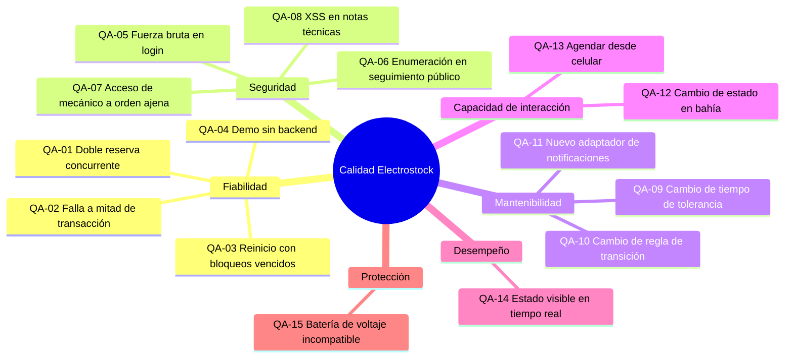

**Escenarios de calidad.** Formato de seis partes. N/T = importancia de negocio / dificultad técnica (A alta, M media, B baja).

| ID | Fuente | Estímulo | Artefacto | Entorno | Respuesta | Medida | N/T | RNF |
|---|---|---|---|---|---|---|---|---|
| QA-01 | 100 clientes | Confirman a la vez la última plaza | Agenda e inventario | Normal | Una sola obtiene la plaza; las demás `409` con sugerencia | 1 éxito, 99 rechazos, 0 `5xx`, invariantes intactos | A/A | RNF-03, 06 |
| QA-02 | Falla de BD | Se pierde la conexión a mitad de la reserva | IniciarAgendamiento | Transacción | Rollback completo; mensaje de reintento | 0 cambios persistidos | A/M | RNF-07 |
| QA-03 | Operador | Reinicia con 20 citas vencidas | Programador | Arranque | Ejecuta la expiración al arrancar | ≤ 2 min; 2.ª ejecución sin efectos | A/M | RNF-08 |
| QA-04 | Presentador | La API no responde en la demo | SPA | Demo | Activa modo mock con aviso | Flujos POC navegables | M/B | RNF-09 |
| QA-05 | Atacante | 50 logins en 1 minuto | Login | Normal | `429` desde el sexto intento por 15 min | 0 intentos procesados tras el quinto | A/B | RNF-13 |
| QA-06 | Atacante | Prueba códigos secuenciales | Seguimiento público | Normal | Códigos aleatorios, límite 30/min, respuesta neutra | Acierto despreciable; `429` desde la 31 | A/M | RNF-13, 15 |
| QA-07 | Mecánico | Cambia una orden ajena | Autorización de órdenes | Normal | `403` auditado, sin cambios | 100 % bloqueado | A/B | RNF-12, 16 |
| QA-08 | Usuario malicioso | Nota con `` | Clientes y vehículos | Normal | Sanitizado; Angular no lo ejecuta | 0 scripts ejecutados | A/B | RNF-14 |
| QA-09 | Docente | Tolerancia de 15 a 20 min | Parámetros | Desarrollo | Cambiar el parámetro y su prueba | ≤ 1 archivo + 1 prueba; ≤ 15 min | A/B | RNF-22, 23 |
| QA-10 | Docente | Permitir cancelar en *En Diagnóstico* | Estado de la orden (State) | Desarrollo | Se cambia solo ese estado y su prueba | 1 clase + 1 prueba | A/B | RNF-22 |
| QA-11 | Equipo | Enviar correos reales | Puerto Notifier | Desarrollo | Nuevo adaptador por configuración | 0 cambios en casos de uso | M/B | RNF-26 |
| QA-12 | Mecánico | De *En Diagnóstico* a *En Reparación* | Panel de bahía | Tablet con guantes | Solo botones válidos | ≤ 2 toques, objetivos ≥ 44 px | A/M | RNF-17, 18 |
| QA-13 | Cliente | Agenda desde celular de gama media | Portal | Red 4G | 3 acciones con contador visible | ≤ 2 min; LCP ≤ 2,5 s; SUS ≥ 68 | A/M | RNF-05, 31 |
| QA-14 | Mecánico | Cambia un estado | Bus de eventos + SSE | Normal | Portal y recepción se actualizan solos | ≤ 2 s | M/M | RNF-04 |
| QA-15 | Mecánico | Batería de 60 V en scooter de 48 V | Órdenes / inventario | Normal | Advertencia con motivo, auditada | 100 % advertido | M/B | RNF-29 |

**Métricas en el ciclo de desarrollo**

| Métrica | Herramienta | Umbral para integrar a `develop` |
|---|---|---|
| Cobertura frontend | Vitest | ≥ 80 % en componentes y servicios POC |
| Cobertura backend | pytest-cov | ≥ 80 % en `domain/` y `application/` |
| Reglas de dependencia | import-linter | 0 violaciones |
| Estilo | ESLint + Prettier; Ruff + Black | 0 errores |
| Tipos | `tsc --strict`; mypy estricto en el dominio | 0 errores |
| Accesibilidad | axe-core | 0 violaciones serias o críticas |

Tácticas y evidencia por escenario: [[AR-1-SAD#10. Requisitos de calidad|SAD 10]].

### 3.7 Organización de los requisitos y modelos de análisis
IEEE 830 permite organizar los requisitos específicos por característica, por clase de usuario o por objeto. Este SRS usa una **organización mixta**:
- **por característica (módulo funcional)** en la sección 3.2;
- **por clase de usuario** en los casos de uso (3.7.1) y en la matriz RBAC (3.2.10);
- **por objeto** en el modelo de clases (3.7.2), las máquinas de estado (3.7.3) y el modelo de datos (3.4).

Los modelos UML 2.5 de esta sección son la vista visual de los requisitos. Cada diagrama está en Figma con su código y aquí en Mermaid como respaldo.

| Tipo de modelo | Diagramas | Cantidad |
|---|---|---|
| Casos de uso | CU-01 a CU-05 | 5 |
| Clases del dominio | DC-01 a DC-03 | 3 |
| Máquinas de estado | DE-01, DE-02 | 2 |
| Secuencia | DS-01 a DS-08 | 8 |
| Actividad | DA-01, DA-02 | 2 |
| Base de datos (3.4) | BD-01 a BD-04 | 4 |
| Identificación de la necesidad (Apéndice A) | AN-01 | 1 |
| **Total** | | **25 diagramas en 7 tipos** (más el índice UI-01 de diseño) |

#### 3.7.1 Casos de uso
Diagramas en Figma: [CU-01 Vista general](https://www.figma.com/design/VuBSMD14Jm4Dt45rAGXTWd/Ingenieria-software-todovisual?node-id=5-2) · [CU-02 Portal público y cliente](https://www.figma.com/design/VuBSMD14Jm4Dt45rAGXTWd/Ingenieria-software-todovisual?node-id=4-145) · [CU-03 Secretaria](https://www.figma.com/design/VuBSMD14Jm4Dt45rAGXTWd/Ingenieria-software-todovisual?node-id=4-198) · [CU-04 Mecánico](https://www.figma.com/design/VuBSMD14Jm4Dt45rAGXTWd/Ingenieria-software-todovisual?node-id=4-250) · [CU-05 Administrador y procesos del sistema](https://www.figma.com/design/VuBSMD14Jm4Dt45rAGXTWd/Ingenieria-software-todovisual?node-id=5-86)

**Catálogo de casos de uso**

| ID | Caso de uso | Actor principal | HU | Diagrama | POC |
|---|---|---|---|---|---|
| UC-01 | Registrarse e iniciar sesión | Visitante, Cliente, usuarios internos | HU-21 | CU-02 | Sí |
| UC-02 | Agendar cita | Cliente, Secretaria en su nombre | HU-01 | CU-02, CU-03 | Sí |
| UC-03 | Reservar repuestos requeridos | Incluido por UC-02 y UC-15 | HU-19 | CU-02, CU-03, CU-04 | Sí |
| UC-04 | Reprogramar o cancelar cita | Cliente | HU-11 | CU-02 | Sí |
| UC-05 | Consultar seguimiento | Visitante con código | HU-07 | CU-02 | Sí |
| UC-06 | Ver historial del vehículo | Cliente | HU-30 | CU-02 | No |
| UC-07 | Registrar cliente y vehículo | Secretaria; Cliente para sus vehículos | HU-22 | CU-02, CU-03 | Sí |
| UC-08 | Registrar ingreso sin cita | Secretaria | HU-03 | CU-03 | Sí |
| UC-09 | Clasificar falla | Incluido por UC-08 | HU-04 | CU-03 | Sí (dentro de HU-03) |
| UC-10 | Crear orden de trabajo | Secretaria | HU-23 | CU-03 | Sí |
| UC-11 | Gestionar calendario y bloqueos | Secretaria | HU-02 | CU-03 | No |
| UC-12 | Liquidar, cobrar y entregar | Secretaria | HU-13, HU-17 | CU-03 | No |
| UC-13 | Cambiar estado de la orden | Mecánico | HU-05 | CU-04 | Sí |
| UC-14 | Consultar expediente técnico | Mecánico; Secretaria en lectura | HU-06 | CU-03, CU-04 | Sí |
| UC-15 | Agregar e instalar repuestos | Mecánico | HU-25, HU-09 | CU-04 | No |
| UC-16 | Asignar mecánico | Administrador | HU-24 | CU-05 | No |
| UC-17 | Gestionar catálogo y repuestos por servicio | Administrador | HU-18, HU-26 | CU-05 | Sí (HU-26) |
| UC-18 | Gestionar inventario | Administrador | HU-08, HU-27, HU-29 | CU-05 | No |
| UC-19 | Gestionar usuarios | Administrador | HU-15 | CU-05 | No |
| UC-20 | Ver reportes y auditoría | Administrador | HU-14, HU-20 | CU-05 | No |
| UC-21 | Liberar reservas vencidas | Programador de tareas | HU-28 | CU-05 | Sí |
| UC-22 | Enviar recordatorios | Programador de tareas, Proveedor de notificaciones | HU-12 | CU-05 | No |
| UC-23 | Responder encuesta | Cliente | HU-16 | CU-02 | No |

HU-10 (autorización por rol) no es un caso de uso propio: es una restricción que aplica a todos los casos de uso (RF-05). En CU-02 el Cliente **especializa** al Visitante: hereda sus casos de uso.

**Respaldo en Mermaid** (Mermaid no tiene tipo nativo de casos de uso; se usa `flowchart`: actores como rectángulos redondeados, casos de uso dentro del límite del sistema, `include` como flecha punteada rotulada):

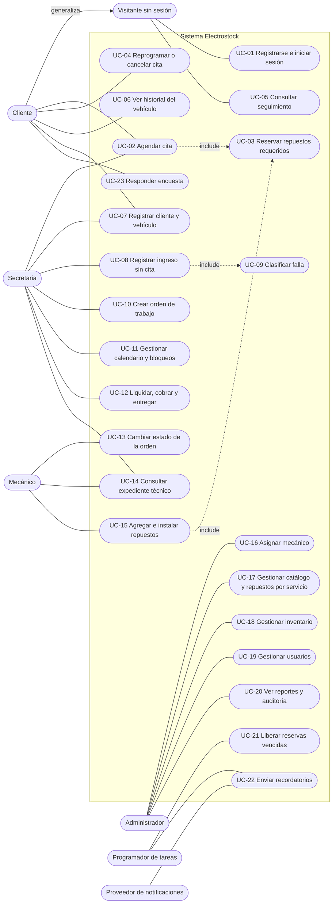

**Especificación de los casos de uso del POC**

**UC-02 Agendar cita** ([[IS-2-HU#HU-01|HU-01]] + [[IS-2-HU#HU-19|HU-19]]) · Diagramas CU-02, DS-01, DA-01

| Campo | Contenido |
|---|---|
| Actor principal | Cliente |
| Precondiciones | Sesión de Cliente activa; al menos un vehículo registrado |
| Disparador | El cliente elige "Agendar cita" |
| Flujo básico | 1. Elige vehículo y servicio. 2. Elige el día en el calendario mensual. 3. El sistema muestra las horas donde cabe el servicio. 4. Elige una hora. 5. El sistema bloquea las franjas, retiene los repuestos (UC-03) y crea la cita *En Proceso* con un contador de 5 min. 6. El cliente confirma. 7. El sistema confirma y muestra el código. |
| Flujos alternos | 4a. Franja llena: se sugiere la siguiente. 5a. Repuesto sin disponible: rechazo con el SKU faltante. 6a. El contador llega a 0: la cita expira (UC-21) y el cliente puede reiniciar. |
| Postcondición | Cita *Confirmada*, cupo ocupado, repuestos reservados |
| Reglas | RN-01 a RN-09, RN-17 |

**UC-04 Reprogramar o cancelar cita** ([[IS-2-HU#HU-11|HU-11]]) · Diagramas CU-02, DS-02

| Campo | Contenido |
|---|---|
| Actor principal | Cliente |
| Precondiciones | Cita *Confirmada* o *Reprogramada* propia; faltan 60 minutos o más |
| Flujo básico (reprogramar) | 1. Elige la cita. 2. Elige nuevo día y hora. 3. El sistema toma las franjas nuevas y libera las originales en una transacción. |
| Flujo básico (cancelar) | 1. Elige la cita. 2. Confirma la cancelación. 3. El sistema libera franjas y repuestos. |
| Flujos alternos | 1a. Faltan menos de 60 min: `409` fuera de la ventana. 3a. Las franjas nuevas no están disponibles: la cita conserva su horario. |
| Reglas | RN-10, RN-11, RN-19 |

**UC-08 Registrar ingreso sin cita** ([[IS-2-HU#HU-03|HU-03]] + [[IS-2-HU#HU-04|HU-04]]) · Diagramas CU-03, DS-05, DA-02

| Campo | Contenido |
|---|---|
| Actor principal | Secretaria |
| Precondiciones | Vehículo registrado (o UC-07 en el mismo flujo) |
| Flujo básico | 1. Busca el vehículo. 2. Selecciona el tipo de falla (UC-09). 3. El sistema calcula la ubicación con la estrategia vigente. 4. Crea la orden *Ingresada*. 5. Actualiza la cola en vivo. |
| Flujos alternos | 3a. Agenda llena: cola con hora estimada. 1a. Vehículo con orden activa: rechazo (RN-23). |
| Postcondición | Orden *Ingresada* sin desplazar citas |

**UC-10 Crear orden de trabajo** ([[IS-2-HU#HU-23|HU-23]]) · Diagramas CU-03, DS-06

| Campo | Contenido |
|---|---|
| Actor principal | Secretaria |
| Precondiciones | Cita del día *Confirmada* o *Reprogramada*; el vehículo no tiene orden activa |
| Flujo básico | 1. Busca la cita. 2. Registra motivo, fallas y kilometraje. 3. El sistema genera número y código de seguimiento, transfiere las reservas y pasa la cita a *Atendida*. 4. Entrega el ticket con QR. |
| Flujos alternos | 3a. Orden activa existente: `409` con su número. |
| Postcondición | Orden *Ingresada* con reservas transferidas |

**UC-13 Cambiar estado de la orden** ([[IS-2-HU#HU-05|HU-05]]) · Diagramas CU-04, DE-02, DS-07

| Campo | Contenido |
|---|---|
| Actor principal | Mecánico |
| Precondiciones | Orden asignada a él |
| Flujo básico | 1. Abre el panel de bahía. 2. El sistema muestra solo las transiciones válidas. 3. Elige y confirma. 4. El sistema aplica la transición, registra el historial y publica el evento. |
| Flujos alternos | 3a. Transición inválida por la API: `409`. 3b. Orden ajena: `403` auditado. 4a. Versión desactualizada: `409`. |
| Postcondición | Estado nuevo visible en recepción y seguimiento en ≤ 2 s |

**UC-14 Consultar expediente técnico** ([[IS-2-HU#HU-06|HU-06]]) · Diagramas CU-04, DS-08

| Campo | Contenido |
|---|---|
| Actor principal | Mecánico |
| Flujo básico | 1. Busca por serie, placa o documento. 2. El sistema muestra ficha eléctrica, órdenes anteriores, repuestos instalados y notas. 3. Opcional: agrega una nota técnica, que se sanitiza antes de guardarse. |
| Flujos alternos | 1a. No existe: `404`. |

**UC-05 Consultar seguimiento** ([[IS-2-HU#HU-07|HU-07]]) · Diagramas CU-02, DS-07

| Campo | Contenido |
|---|---|
| Actor principal | Visitante sin sesión (cliente con su código) |
| Flujo básico | 1. Ingresa o escanea el código. 2. El sistema valida el formato y responde con la proyección pública. 3. Se suscribe a eventos SSE. |
| Flujos alternos | 2a. Código inexistente: mensaje neutro. 2b. Más de 30 consultas por minuto: `429`. |

**UC-21 Liberar reservas vencidas** ([[IS-2-HU#HU-28|HU-28]]) · Diagramas CU-05, DS-03

| Campo | Contenido |
|---|---|
| Actor principal | Programador de tareas |
| Disparador | Cada 60 s y al arrancar |
| Flujo básico | 1. Selecciona citas vencidas con `SKIP LOCKED`. 2. Por cada una: cambia el estado y libera franjas y reservas. 3. Publica eventos. |
| Garantía | Idempotente; sin efectos duplicados |

**UC-01 Registrarse e iniciar sesión** ([[IS-2-HU#HU-21|HU-21]]), **UC-07 Registrar cliente y vehículo** ([[IS-2-HU#HU-22|HU-22]]) y **UC-17 Repuestos por servicio** ([[IS-2-HU#HU-26|HU-26]]) siguen el flujo de formulario descrito en sus HU; sus secuencias son DS-04 y DS-05.

#### 3.7.2 Modelo de clases del dominio
Diagramas en Figma: [DC-01 Identidad, clientes y vehículos](https://www.figma.com/design/VuBSMD14Jm4Dt45rAGXTWd/Ingenieria-software-todovisual?node-id=5-133) · [DC-02 Catálogo, agenda e inventario](https://www.figma.com/design/VuBSMD14Jm4Dt45rAGXTWd/Ingenieria-software-todovisual?node-id=5-243) · [DC-03 Órdenes y facturación](https://www.figma.com/design/VuBSMD14Jm4Dt45rAGXTWd/Ingenieria-software-todovisual?node-id=5-400)

Modelo conceptual agrupado por módulo. Las clases son **objetos de dominio puros**, sin anotaciones de persistencia (ADR-10). Los nombres son conceptuales en español; su identificador en código está en [[AR-1-SAD#2.4 Diccionario de nombres|SAD 2.4]] y su tabla en [[#3.4.3 Diccionario de datos|3.4.3]].

**DC-01 Identidad, clientes y vehículos**

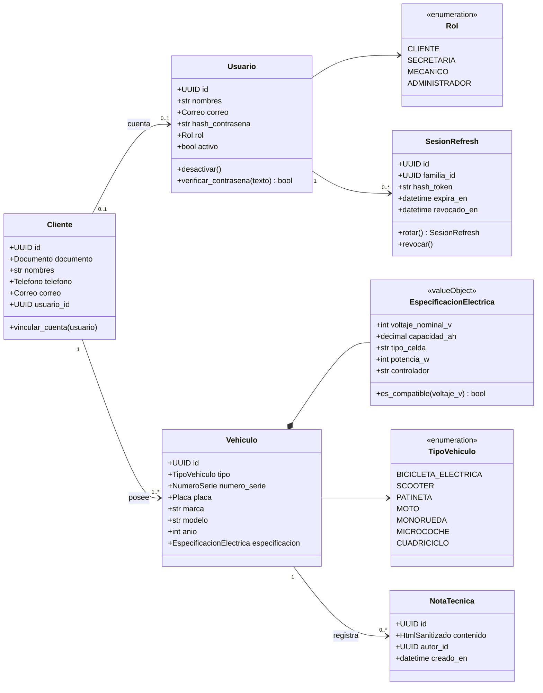

**DC-02 Catálogo, agenda e inventario**

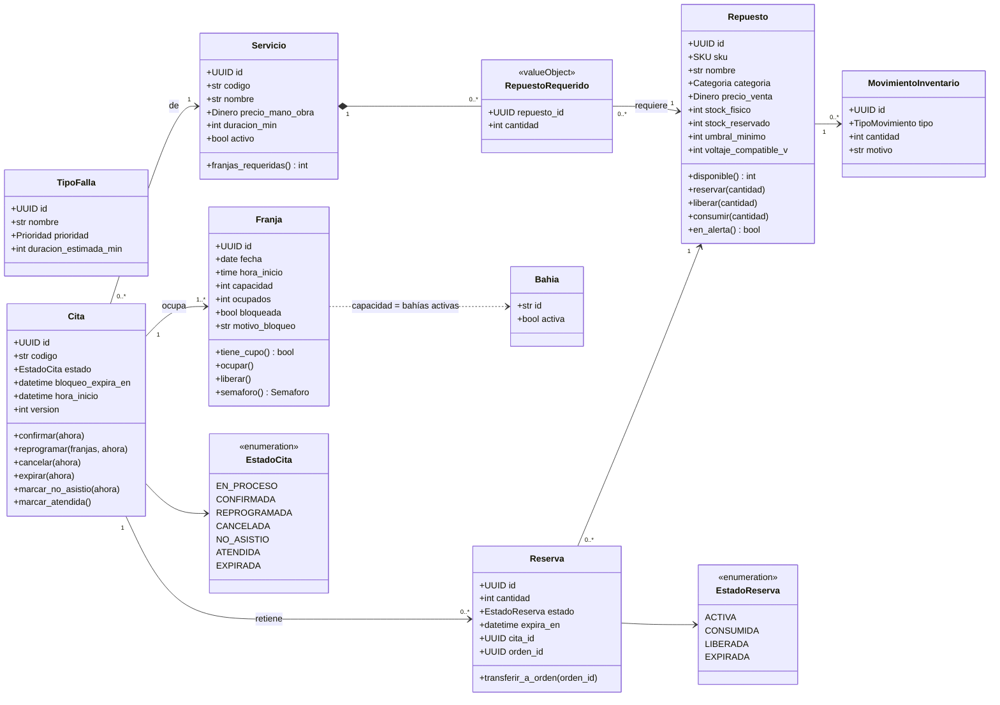

**DC-03 Órdenes y facturación**

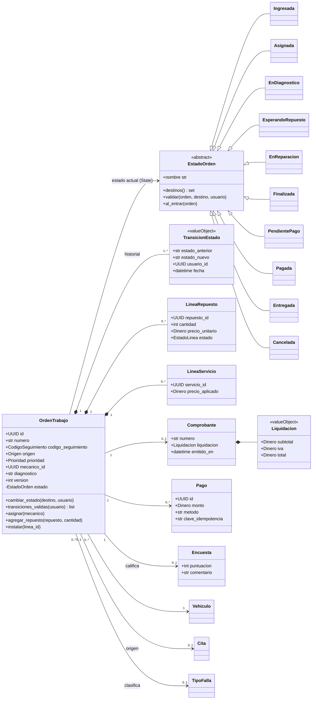

Una orden puede tener **varios pagos** en el modelo (por ejemplo, un pago rechazado y uno exitoso), aunque RN-38 exige que el pago aceptado sea por el total exacto.

**Objetos de valor y su validación**

| Objeto de valor | Invariante |
|---|---|
| `Correo` | RFC 5322 simplificado; en minúsculas |
| `Documento` | CC: 6-10 dígitos. CE: 6-12 alfanuméricos. PA: 6-12 alfanuméricos |
| `NumeroSerie` | `^[A-Z0-9-]{5,30}$`, en mayúsculas |
| `Placa` | Opcional; `^[A-Z]{3}[0-9]{2}[A-Z]$` (moto) o `^[A-Z]{3}[0-9]{3}$` |
| `SKU` | `^[A-Z0-9-]{3,30}$` |
| `Dinero` | Entero no negativo en COP |
| `CodigoSeguimiento` | `^[A-HJ-NP-Z2-9]{10}$`; se persiste como hash |
| `HtmlSanitizado` | Solo se construye a través del sanitizador |

#### 3.7.3 Máquinas de estado
Diagramas en Figma: [DE-01 Cita](https://www.figma.com/design/VuBSMD14Jm4Dt45rAGXTWd/Ingenieria-software-todovisual?node-id=6-2) · [DE-02 Orden de trabajo](https://www.figma.com/design/VuBSMD14Jm4Dt45rAGXTWd/Ingenieria-software-todovisual?node-id=7-2)

La **Cita** y la **Orden de trabajo** son entidades distintas, cada una con su máquina (ADR-05). La cita es una **promesa** de capacidad e insumos; la orden es el **trabajo real**. Se conectan en un único punto: crear la orden desde una cita la pasa a *Atendida*.

**DE-01 Cita**

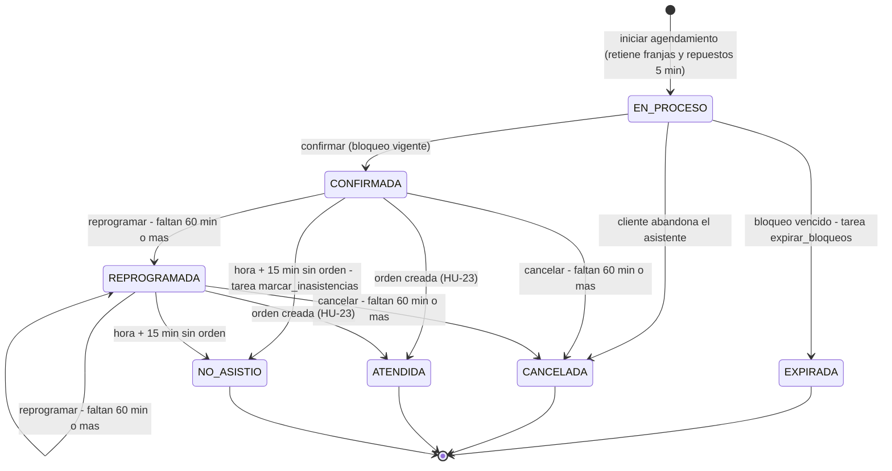

| Estado | Ocupa franja | Retiene repuestos | Activa (RN-13) |
|---|:---:|:---:|:---:|
| EN_PROCESO | Sí (temporal) | Sí (temporal) | Sí |
| CONFIRMADA | Sí | Sí | Sí |
| REPROGRAMADA | Sí | Sí | Sí |
| ATENDIDA | Pasa a la orden | Transferidos a la orden | No |
| CANCELADA, EXPIRADA, NO_ASISTIO | No | No (liberados) | No |

| Transición | Quién | Efecto colateral |
|---|---|---|
| Iniciar, confirmar | Cliente (o Secretaria en su nombre) | Reserva temporal → firme |
| Reprogramar, cancelar | Cliente, Secretaria; el Administrador puede saltarse la ventana | Libera o mueve franjas; cancelar libera repuestos |
| Expirar, no asistió | Programador | Libera franjas y repuestos |
| Atendida | Secretaria al crear la orden | Reservas pasan de la cita a la orden |

**DE-02 Orden de trabajo**

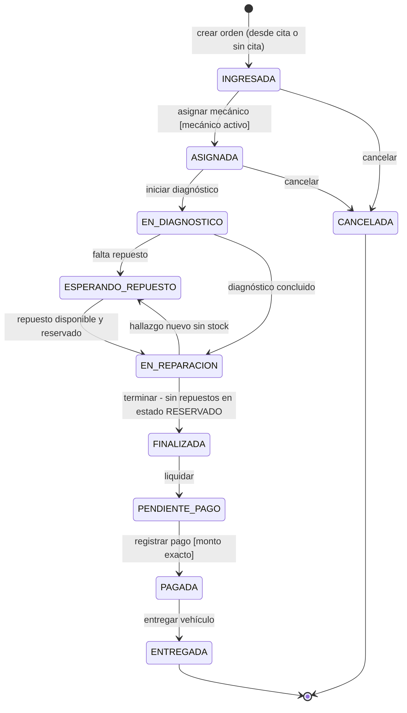

**Transiciones y permisos**

| Desde | Hacia | Rol autorizado | Guardas | Efectos |
|---|---|---|---|---|
| (nuevo) | INGRESADA | Secretaria, Administrador | RN-23 | Número + código; cita *Atendida*; transfiere reservas |
| INGRESADA | ASIGNADA | Administrador | Mecánico activo | Aparece en el panel de bahía |
| INGRESADA, ASIGNADA | CANCELADA | Secretaria, Administrador | - | Libera todas las reservas |
| ASIGNADA | EN_DIAGNOSTICO | Mecánico asignado | - | - |
| EN_DIAGNOSTICO | ESPERANDO_REPUESTO | Mecánico asignado | - | - |
| EN_DIAGNOSTICO | EN_REPARACION | Mecánico asignado | - | - |
| ESPERANDO_REPUESTO | EN_REPARACION | Mecánico asignado | - | - |
| EN_REPARACION | ESPERANDO_REPUESTO | Mecánico asignado | - | - |
| EN_REPARACION | FINALIZADA | Mecánico asignado | RN-30 | Fecha de finalización |
| FINALIZADA | PENDIENTE_PAGO | Secretaria, Administrador | Total > 0 | Liquidación congelada |
| PENDIENTE_PAGO | PAGADA | Secretaria, Administrador | RN-38 | Comprobante inmutable |
| PAGADA | ENTREGADA | Secretaria, Administrador | - | Token de encuesta |

Toda transición registra estado anterior, nuevo, usuario, fecha-hora y `correlation_id`, y publica *EstadoOrdenCambiado* (SSE, auditoría, seguimiento). La implementación usa el patrón **State**: una clase por estado que declara sus transiciones y guardas (DC-03; bosquejo en [[AR-1-SAD#8.13 Patrones de diseño GoF|SAD 8.13]]).

**Vista pública (seguimiento)**

| Estados internos | Etiqueta pública |
|---|---|
| INGRESADA, ASIGNADA | Recibido |
| EN_DIAGNOSTICO | En diagnóstico |
| ESPERANDO_REPUESTO | Esperando repuesto |
| EN_REPARACION | En reparación |
| FINALIZADA, PENDIENTE_PAGO, PAGADA | Listo para entrega |
| ENTREGADA | Entregado |
| CANCELADA | Cancelado |

**Alias de las etiquetas del backlog original.** La línea base v0.2 acordó alias para las etiquetas resumidas de [[HU-propuesta]]. Se conservan como entrada aceptada por la API:

| Etiqueta del backlog original | Estado interno v2 |
|---|---|
| En espera | Ingresada |
| En diagnóstico | En Diagnóstico |
| Esperando repuesto | Esperando Repuesto |
| Listo | Finalizada (en la v0.2: *Reparación finalizada*) |

**Diferencias con la máquina de la línea base v0.2**

| Aspecto | v0.2 | v2 | Motivo |
|---|---|---|---|
| *Esperando Repuesto* desde *En Diagnóstico* | No | Sí | El diagnóstico es cuando se descubre la falta del repuesto |
| Cancelar en *En Diagnóstico* | Sí | No (RN-28) | Tras diagnosticar hay trabajo técnico invertido. Cambiarlo es una línea en el estado (QA-10) |
| *Esperando Repuesto* → *En Reparación* por el Administrador | Sí | No; solo el mecánico asignado | Responsabilidad única del técnico |
| Código HTTP de transición inválida | 422 | 409 | Conflicto con el estado actual del recurso (RFC 9110) |

#### 3.7.4 Diagramas de secuencia
Diagramas en Figma: [DS-01](https://www.figma.com/design/VuBSMD14Jm4Dt45rAGXTWd/Ingenieria-software-todovisual?node-id=7-75) · [DS-02](https://www.figma.com/design/VuBSMD14Jm4Dt45rAGXTWd/Ingenieria-software-todovisual?node-id=7-182) · [DS-03](https://www.figma.com/design/VuBSMD14Jm4Dt45rAGXTWd/Ingenieria-software-todovisual?node-id=7-260) · [DS-04](https://www.figma.com/design/VuBSMD14Jm4Dt45rAGXTWd/Ingenieria-software-todovisual?node-id=7-309) · [DS-05](https://www.figma.com/design/VuBSMD14Jm4Dt45rAGXTWd/Ingenieria-software-todovisual?node-id=7-386) · [DS-06](https://www.figma.com/design/VuBSMD14Jm4Dt45rAGXTWd/Ingenieria-software-todovisual?node-id=7-464) · [DS-07](https://www.figma.com/design/VuBSMD14Jm4Dt45rAGXTWd/Ingenieria-software-todovisual?node-id=7-541) · [DS-08](https://www.figma.com/design/VuBSMD14Jm4Dt45rAGXTWd/Ingenieria-software-todovisual?node-id=7-639)

| Código | Flujo | HU | Fragmentos UML |
|---|---|---|---|
| DS-01 | Agendar con reserva de repuestos | HU-01, HU-19, HU-26 | `alt` anidado: sin cupo / falta repuesto |
| DS-02 | Reprogramar o cancelar cita | HU-11 | `opt` fuera de ventana; `alt` reprogramar / cancelar |
| DS-03 | Expiración automática de reservas | HU-28 | `loop` cada 60 s; `loop` por cita |
| DS-04 | Inicio de sesión y renovación | HU-21 | `alt` token reutilizado / válido |
| DS-05 | Ingreso sin cita | HU-03, HU-04, HU-22 | `opt` vehículo inexistente |
| DS-06 | Crear orden de trabajo | HU-23, HU-17 | `alt` orden activa existente |
| DS-07 | Cambio de estado y seguimiento en vivo | HU-05, HU-07 | `alt` transición inválida |
| DS-08 | Consultar expediente y agregar nota | HU-06 | `alt` vehículo inexistente |

La vista de tiempo de ejecución ([[AR-1-SAD#6. Vista de tiempo de ejecución|SAD 6]]) agrega los bloqueos y las garantías. Respaldo en Mermaid de los cuatro flujos más críticos:

**DS-01 Agendar cita con reserva de repuestos**

```mermaid
sequenceDiagram
    autonumber
    actor C as Cliente
    participant UI as SPA agendar-cita
    participant API as API agenda
    participant UC as IniciarAgendamiento
    participant FR as RepositorioFranjas
    participant RR as ReservadorRepuestos (inventario)
    participant DB as MySQL

    C->>UI: elige vehículo, servicio, día y hora 10:00
    UI->>API: POST /scheduling/appointments {vehicle_id, service_id, date, time}
    API->>UC: ejecutar(comando, usuario)
    UC->>DB: BEGIN
    UC->>FR: bloquear_secuencia(fecha, 10:00, n_franjas)
    FR->>DB: SELECT ... FROM slots WHERE ... ORDER BY id FOR UPDATE
    alt alguna franja sin cupo o bloqueada
        UC->>DB: ROLLBACK
        UC-->>API: FranjaNoDisponible(siguiente)
        API-->>UI: 409 {siguiente_franja}
        UI-->>C: "Alguien acaba de tomar este cupo..."
    else hay cupo
        UC->>RR: reservar(servicio.requeridos, expira_en = ahora+5min)
        RR->>DB: SELECT ... FROM parts WHERE id IN (...) ORDER BY id FOR UPDATE
        alt disponible insuficiente
            RR-->>UC: RepuestoNoDisponible([sku])
            UC->>DB: ROLLBACK
            API-->>UI: 409 {repuestos_faltantes}
        else disponible suficiente
            RR->>DB: UPDATE parts SET reserved_stock = reserved_stock + n
            RR->>DB: INSERT part_reservations (ACTIVE)
            UC->>DB: UPDATE slots SET booked_count = booked_count + 1
            UC->>DB: INSERT appointments (HELD, hold_expires_at)
            UC->>DB: COMMIT
            API-->>UI: 201 {id, hold_expires_at, repuestos}
            UI-->>C: resumen + contador 05:00
        end
    end
    C->>UI: Confirmar cita
    UI->>API: POST /scheduling/appointments/{id}/confirm
    API->>DB: SELECT appointment FOR UPDATE (HELD y bloqueo vigente)
    API->>DB: UPDATE appointment CONFIRMED; reservas vencen a hora + 15 min; COMMIT
    API-->>UI: 200 {code}
```

**DS-07 Cambio de estado con difusión en tiempo real**

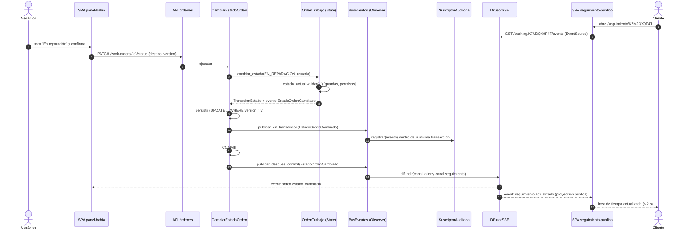

**DS-03 Expiración automática**

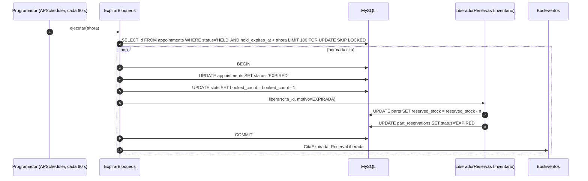

**DS-04 Inicio de sesión y renovación**

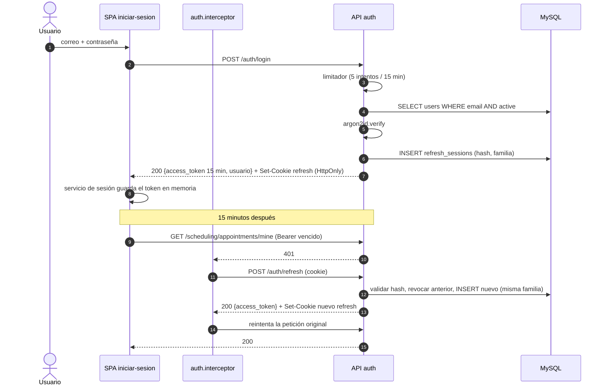

#### 3.7.5 Diagramas de actividad
Diagramas en Figma: [DA-01 Proceso completo del taller](https://www.figma.com/design/VuBSMD14Jm4Dt45rAGXTWd/Ingenieria-software-todovisual?node-id=8-3) · [DA-02 Ingreso sin cita](https://www.figma.com/design/VuBSMD14Jm4Dt45rAGXTWd/Ingenieria-software-todovisual?node-id=8-181)

Proceso completo del taller con carriles por rol. Es la base de las pruebas de extremo a extremo ([[IS-5-pruebas#1. Plan de pruebas|plan de pruebas]]).

**DA-01 Flujo de punta a punta**

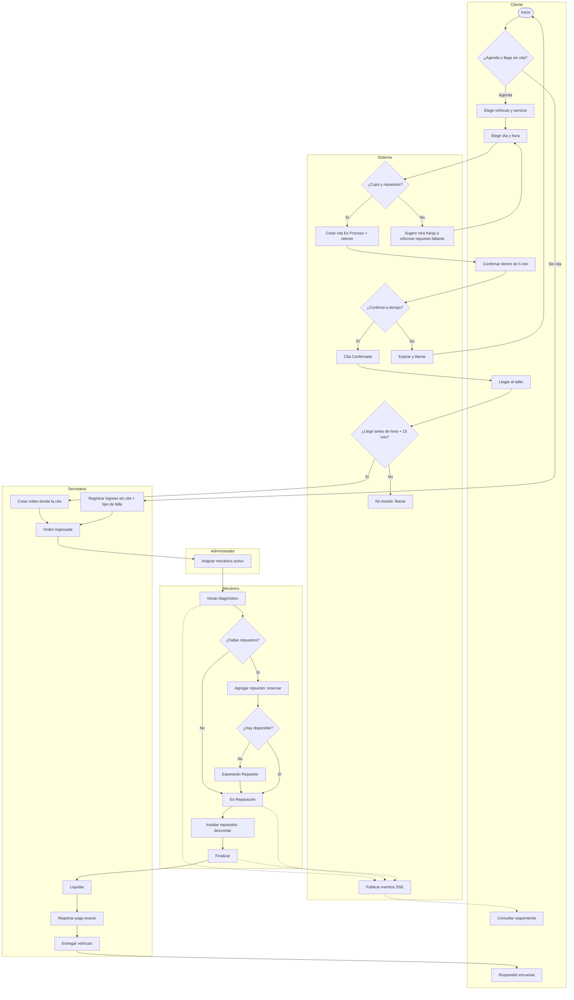

**DA-02 Ingreso sin cita**

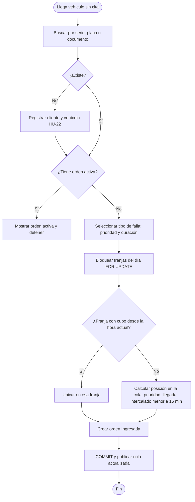

### 3.8 Información adicional
- **Protección de datos (Ley 1581 de 2012):** el registro de cliente pide autorización de tratamiento de datos; el seguimiento público usa una proyección sin datos personales (RNF-15); los logs no contienen datos sensibles (RNF-24).
- **Fotos del vehículo:** las pantallas reservan un espacio provisional; la función se especificará en una fase posterior (ADR-15). No hay requisito funcional asociado en esta versión.
- **Evolución prevista:** notificaciones reales, facturación electrónica, fotos del vehículo y versión tablet del panel de bahía con diseño propio.
- **Pruebas:** el plan, los 50 casos de prueba y los datos de prueba están en [[IS-5-pruebas]].

---

## Apéndice A. Identificación de la necesidad
Diagrama en Figma: [AN-01 Árbol de problemas](https://www.figma.com/design/VuBSMD14Jm4Dt45rAGXTWd/Ingenieria-software-todovisual?node-id=4-2)

### A.1 Caso de origen
La necesidad nace de una experiencia directa del equipo, registrada aquí como **evidencia de observación**:

| Dato | Detalle |
|---|---|
| Fecha y lugar | Julio de 2026, aproximadamente; Bogotá |
| Protagonista | Carlos Leonardo López Cárdenas, integrante del equipo, propietario de una motocicleta eléctrica marca Mobula |
| Taller | Taller de mantenimiento de vehículos eléctricos. No se nombra por razones legales |
| Qué pasó | 1. Esperó cerca de **7 horas**, porque el mecánico no tenía disponibilidad. 2. Al final **no hubo solución**: la parte eléctrica que se necesitaba no estaba en el taller. 3. Se perdió el día completo. |
| Observación adicional | El taller llevaba su información en **hojas de Excel desorganizadas**. |

**Alcance de la evidencia.** Es un caso único observado por el equipo. Sirve como origen y como hipótesis del problema; los indicadores de los objetivos (OB-01 a OB-05) se medirán con datos reales cuando el sistema opere. No se presentan cifras de mercado que no se hayan medido.

### A.2 Planteamiento del problema
En el taller del caso de origen, el cliente llegó, esperó y se fue sin servicio. Las tres fallas son de coordinación, no de capacidad técnica:
1. La agenda no sabía si el repuesto existía.
2. Nadie sabía cuándo estaría libre un mecánico.
3. El inventario estaba en hojas de cálculo que nadie consultaba al recibir el vehículo.

**Problema central:** los talleres de vehículos eléctricos livianos aceptan servicios que no pueden atender, porque la agenda no está coordinada con el inventario ni con la capacidad de los mecánicos.

### A.3 Árbol de problemas

| Nivel | ID | Descripción |
|---|---|---|
| Causa | C1 | La agenda acepta citas sin verificar el inventario |
| Causa | C2 | El inventario se lleva en hojas de Excel desorganizadas |
| Causa | C3 | No hay control de la disponibilidad de los mecánicos |
| Causa | C4 | No hay canal de seguimiento del servicio para el cliente |
| Problema | P | Se aceptan servicios que no se pueden atender |
| Efecto | E1 | El cliente pierde el día: 7 horas de espera sin solución |
| Efecto | E2 | Vehículos inmovilizados en bahía esperando repuestos |
| Efecto | E3 | Insatisfacción y pérdida de confianza del cliente |
| Efecto | E4 | Llamadas y visitas repetidas para saber el estado |
| Efecto | E5 | Inventario poco confiable y compras tardías |

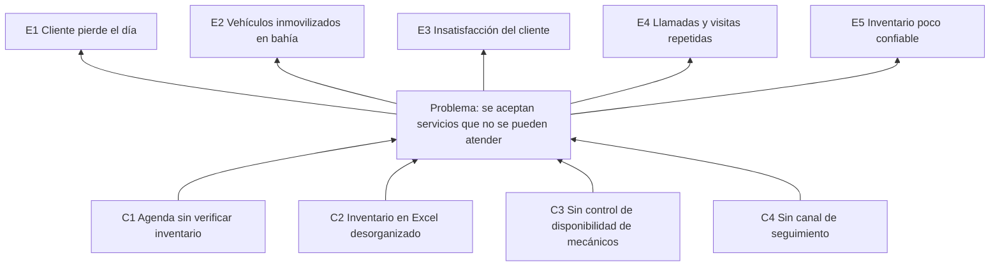

### A.4 Afectados

| Afectado | Cómo lo afecta el problema |
|---|---|
| Cliente propietario del vehículo | Pierde tiempo y no recibe solución; no sabe en qué estado está su vehículo |
| Secretaria (recepción) | Recibe vehículos sin saber si se podrán atender; responde llamadas de estado |
| Mecánico | Diagnostica y luego no puede reparar; su bahía queda ocupada sin producir |
| Administrador del taller | No conoce el inventario real ni la capacidad; pierde clientes y compra tarde |

### A.5 Situación actual
Según lo observado, el taller del caso de origen:
- recibe vehículos sin una agenda que considere el inventario;
- lleva su información en hojas de Excel desorganizadas;
- no informa al cliente cuánto esperará ni en qué va su servicio.

Una agenda convencional o una hoja de cálculo de inventario resuelven cada parte por separado, pero ninguna **reserva el repuesto en el momento de agendar**. Esa es la diferencia que propone Electrostock (declaración de visión en [[#1.2 Alcance|1.2]]).

### A.6 Necesidad formulada
El taller necesita **confirmar solo los servicios que puede atender**: con bahía libre, mecánico disponible y el repuesto apartado en el mismo instante en que se agenda, y con un canal para que el cliente siga su servicio sin llamar ni esperar en el taller.

### A.7 Justificación
- **Para el cliente:** no vuelve a perder un día; agenda solo si hay repuesto y sigue su servicio desde el celular.
- **Para el taller:** sus bahías producen en lugar de esperar; el inventario refleja lo comprometido; la recepción deja de atender llamadas de estado.
- **Para el proyecto académico:** el problema exige resolver concurrencia, consistencia transaccional y tiempo real, que son los atributos de calidad que se evalúan en arquitectura de software.

### A.8 Objetivos
**Objetivo general.** Desarrollar una plataforma web responsive que coordine la agenda, el inventario y la capacidad de un taller de vehículos eléctricos livianos, de modo que solo se confirmen servicios con repuestos reservados y bahía disponible.

**Objetivos específicos**

| ID | Objetivo específico | Causa que ataca | Requisitos | Indicador |
|---|---|---|---|---|
| OE-01 | Reservar los repuestos requeridos al agendar y rechazar la cita si falta alguno | C1 | RF-14, RF-17, RF-18, RF-30 | OB-01 |
| OE-02 | Llevar el inventario con stock físico, reservado y disponible, con entradas, bajas y alertas | C2 | RF-27 a RF-32 | OB-04 |
| OE-03 | Controlar la capacidad por franja y la asignación de mecánicos | C3 | RF-16, RF-23, RF-24, RF-34 | OB-02 |
| OE-04 | Ofrecer seguimiento público del servicio en tiempo real | C4 | RF-39, RF-40 | OB-03 |
| OE-05 | Registrar el historial completo de cada orden | C2, C3 | RF-35, RF-47 | OB-05 |

Cada efecto del árbol queda cubierto: E1 por OE-01 y OE-03; E2 por OE-01; E3 por OE-04; E4 por OE-04; E5 por OE-02.

---

## Apéndice B. Matriz de trazabilidad
Relación entre HU, requisitos, casos de uso, diagramas y vistas. La trazabilidad hacia los casos de prueba está en [[IS-5-pruebas#4. Matriz de trazabilidad|IS-5 sección 4]].

| HU | RF | Caso de uso | Diagramas | Vista ([[IS-4-diseno-interfaz]]) | POC |
|---|---|---|---|---|---|
| HU-01 | RF-16 a RF-19 | UC-02 | CU-02, DS-01, DE-01, DA-01 | CL-02 a CL-05 | Sí |
| HU-02 | RF-23 | UC-11 | CU-03, DC-02 | SE-01 | No |
| HU-03 | RF-24 | UC-08 | CU-03, DS-05, DA-02 | SE-02 | Sí |
| HU-04 | RF-15, RF-25 | UC-09 | CU-03, DA-02 | SE-02 | No |
| HU-05 | RF-35, RF-36, RF-40 | UC-13 | CU-04, DE-02, DS-07 | ME-01, ME-02 | Sí |
| HU-06 | RF-09 a RF-11 | UC-14 | CU-04, DS-08, DC-01 | ME-03 | Sí |
| HU-07 | RF-39, RF-40 | UC-05 | CU-02, DS-07 | PU-03 | Sí |
| HU-08 | RF-29, RF-32 | UC-18 | CU-05, DC-02 | AD-03 | No |
| HU-09 | RF-38 | UC-15 | CU-04, DC-03 | ME-02 | No |
| HU-10 | RF-05 | Transversal | CU-01 | Todas (guardias) | Base |
| HU-11 | RF-20, RF-21, RF-31 | UC-04 | CU-02, DS-02, DE-01 | CL-01, CL-06 | Sí |
| HU-12 | RF-26 | UC-22 | CU-05 | Sin vista | No |
| HU-13 | RF-41, RF-42, RF-44 | UC-12 | CU-03, DE-02 | SE-05 | No |
| HU-14 | RF-46 | UC-20 | CU-05 | AD-01 | No |
| HU-15 | RF-06 | UC-19 | CU-05, DC-01 | AD-05 | No |
| HU-16 | RF-45 | UC-23 | CU-02, DC-03 | CL-09 | No |
| HU-17 | RF-43 | UC-12 | CU-03, DS-06 | SE-04, SE-05 | No |
| HU-18 | RF-13 | UC-17 | CU-05, DC-02 | AD-04 | No |
| HU-19 | RF-30 | UC-03 | CU-02, DS-01 | CL-02 a CL-05 | Sí |
| HU-20 | RF-47 | UC-20 | CU-05, BD-04 | AD-06 | No |
| HU-21 | RF-01 a RF-04 | UC-01 | CU-02, DS-04 | PU-01, PU-02 | Sí |
| HU-22 | RF-07, RF-08 | UC-07 | CU-02, CU-03, DS-05 | SE-03, CL-07 | Sí |
| HU-23 | RF-33 | UC-10 | CU-03, DS-06, DE-02 | SE-04 | Sí |
| HU-24 | RF-34 | UC-16 | CU-05, DE-02 | AD-02 | No |
| HU-25 | RF-37 | UC-15 | CU-04, DC-03 | ME-02 | No |
| HU-26 | RF-14 | UC-17 | CU-05, DC-02, DS-01 | AD-04 | Sí |
| HU-27 | RF-28 | UC-18 | CU-05, DC-02 | AD-03 | No |
| HU-28 | RF-22, RF-31 | UC-21 | CU-05, DS-03, DE-01 | Sin vista (efecto en CL-04 y SE-01) | Sí |
| HU-29 | RF-27 | UC-18 | CU-05, DC-02 | AD-03 | No |
| HU-30 | RF-12 | UC-06 | CU-02 | CL-08 (enlace desde CL-01) | No |

Resultado: las 30 HU tienen al menos un requisito funcional y un modelo; 27 tienen vista. HU-10 es transversal y HU-12 y HU-28 son procesos del sistema sin pantalla.

---

## Apéndice C. Correspondencia con ISO 29148 y con la versión anterior

| IEEE 830-1998 (este documento) | ISO/IEC/IEEE 29148:2018, contenido del SRS | Versión 2.0 (`IS-1-requisitos` + `IS-3-UML`) |
|---|---|---|
| 1.1 Propósito | 9.6.2 Propósito | 3.1 Introducción |
| 1.2 Alcance | 9.6.3 Alcance | 1.2 Visión, 1.3 Objetivos, 1.4 Alcance, 1.8 Criterios de éxito |
| 1.3 Definiciones | 9.6.5 Definiciones | (nuevo) |
| 1.4 Referencias | 9.6.18 Referencias | 3.1 Referencias |
| 2.1 Perspectiva del producto | 9.6.4 Perspectiva del producto | 3.1 Perspectiva |
| 2.2 Funciones del producto | 9.6.4.2 Funciones | 3.1 Funciones |
| 2.3 Características de los usuarios | 9.6.4.3 Características de los usuarios | 1.5 Actores, 3.1 Tabla de roles |
| 2.4 Restricciones | 9.6.4.4 Limitaciones | 1.7 Restricciones |
| 2.5 Suposiciones y dependencias | 9.6.4.5 Suposiciones | 1.6 Supuestos |
| 2.6 Prorrateo | 9.6.4.6 Prorrateo | 1.4 Fuera de alcance |
| 3.1 Interfaces externas | 9.6.11 Interfaces externas | 3.1 Interfaces, 3.10 RIE |
| 3.2 Requisitos funcionales | 9.6.12 Funciones | 2. Reglas de negocio, 3.2 a 3.9 RF, 3.11 RBAC |
| 3.3 Rendimiento | 9.6.13 Usabilidad y desempeño | 4.1 Eficiencia de desempeño |
| 3.4 Base de datos | 9.6.14 Requisitos lógicos de la base de datos | (estaba en SAD 5.4; ahora completo aquí) |
| 3.5 Restricciones de diseño | 9.6.15 Restricciones de diseño | 1.7 Restricciones; IS-4 sección 1 (Angular) |
| 3.6 Atributos del sistema | 9.6.16 Atributos del sistema | 4.2 a 4.8 RNF, 5. Atributos de calidad |
| 3.7 Modelos | 9.6.17 Información de soporte | IS-3 secciones 1 a 5 |
| Apéndice A Necesidad | 9.6.3 Alcance (beneficios y objetivos) | 1.1 Problema |
| Apéndice B Trazabilidad | 9.6.19 Trazabilidad | IS-5 sección 4 |

Ningún contenido de la versión 2.0 se perdió: las 49 reglas, 47 RF, 31 RNF, 15 escenarios de calidad y los modelos UML se conservan con los mismos identificadores. Los casos de uso pasan de `UC01` a `UC-01` y se agrega **UC-23 Responder encuesta** (HU-16). Las versiones 2.0 están en `_archivo/version-2/`.

---

## Apéndice D. Índice de figuras
Todos los diagramas están en el archivo de Figma [Ingeniería de software: todo visual](https://www.figma.com/design/VuBSMD14Jm4Dt45rAGXTWd/Ingenieria-software-todovisual?node-id=11-2), organizado en 9 páginas.

| Código | Diagrama | Notación | Sección | Enlace |
|---|---|---|---|---|
| AN-01 | Árbol de problemas | Marco lógico | Apéndice A | [Abrir](https://www.figma.com/design/VuBSMD14Jm4Dt45rAGXTWd/Ingenieria-software-todovisual?node-id=4-2) |
| CU-01 | Casos de uso: vista general | UML 2.5 | 2.2, 3.7.1 | [Abrir](https://www.figma.com/design/VuBSMD14Jm4Dt45rAGXTWd/Ingenieria-software-todovisual?node-id=5-2) |
| CU-02 | Casos de uso: portal público y cliente | UML 2.5 | 3.7.1 | [Abrir](https://www.figma.com/design/VuBSMD14Jm4Dt45rAGXTWd/Ingenieria-software-todovisual?node-id=4-145) |
| CU-03 | Casos de uso: secretaria | UML 2.5 | 3.7.1 | [Abrir](https://www.figma.com/design/VuBSMD14Jm4Dt45rAGXTWd/Ingenieria-software-todovisual?node-id=4-198) |
| CU-04 | Casos de uso: mecánico | UML 2.5 | 3.7.1 | [Abrir](https://www.figma.com/design/VuBSMD14Jm4Dt45rAGXTWd/Ingenieria-software-todovisual?node-id=4-250) |
| CU-05 | Casos de uso: administrador y procesos del sistema | UML 2.5 | 3.7.1 | [Abrir](https://www.figma.com/design/VuBSMD14Jm4Dt45rAGXTWd/Ingenieria-software-todovisual?node-id=5-86) |
| DC-01 | Clases: identidad, clientes y vehículos | UML 2.5 | 3.7.2 | [Abrir](https://www.figma.com/design/VuBSMD14Jm4Dt45rAGXTWd/Ingenieria-software-todovisual?node-id=5-133) |
| DC-02 | Clases: catálogo, agenda e inventario | UML 2.5 | 3.7.2 | [Abrir](https://www.figma.com/design/VuBSMD14Jm4Dt45rAGXTWd/Ingenieria-software-todovisual?node-id=5-243) |
| DC-03 | Clases: órdenes y facturación | UML 2.5 | 3.7.2 | [Abrir](https://www.figma.com/design/VuBSMD14Jm4Dt45rAGXTWd/Ingenieria-software-todovisual?node-id=5-400) |
| DE-01 | Máquina de estados: cita | UML 2.5 | 3.7.3 | [Abrir](https://www.figma.com/design/VuBSMD14Jm4Dt45rAGXTWd/Ingenieria-software-todovisual?node-id=6-2) |
| DE-02 | Máquina de estados: orden de trabajo | UML 2.5 | 3.7.3 | [Abrir](https://www.figma.com/design/VuBSMD14Jm4Dt45rAGXTWd/Ingenieria-software-todovisual?node-id=7-2) |
| DS-01 | Secuencia: agendar con reserva de repuestos | UML 2.5 | 3.7.4 | [Abrir](https://www.figma.com/design/VuBSMD14Jm4Dt45rAGXTWd/Ingenieria-software-todovisual?node-id=7-75) |
| DS-02 | Secuencia: reprogramar o cancelar cita | UML 2.5 | 3.7.4 | [Abrir](https://www.figma.com/design/VuBSMD14Jm4Dt45rAGXTWd/Ingenieria-software-todovisual?node-id=7-182) |
| DS-03 | Secuencia: expiración automática de reservas | UML 2.5 | 3.7.4 | [Abrir](https://www.figma.com/design/VuBSMD14Jm4Dt45rAGXTWd/Ingenieria-software-todovisual?node-id=7-260) |
| DS-04 | Secuencia: inicio de sesión y renovación | UML 2.5 | 3.7.4 | [Abrir](https://www.figma.com/design/VuBSMD14Jm4Dt45rAGXTWd/Ingenieria-software-todovisual?node-id=7-309) |
| DS-05 | Secuencia: ingreso sin cita | UML 2.5 | 3.7.4 | [Abrir](https://www.figma.com/design/VuBSMD14Jm4Dt45rAGXTWd/Ingenieria-software-todovisual?node-id=7-386) |
| DS-06 | Secuencia: crear orden de trabajo | UML 2.5 | 3.7.4 | [Abrir](https://www.figma.com/design/VuBSMD14Jm4Dt45rAGXTWd/Ingenieria-software-todovisual?node-id=7-464) |
| DS-07 | Secuencia: cambio de estado y seguimiento en vivo | UML 2.5 | 3.7.4 | [Abrir](https://www.figma.com/design/VuBSMD14Jm4Dt45rAGXTWd/Ingenieria-software-todovisual?node-id=7-541) |
| DS-08 | Secuencia: consultar expediente y agregar nota | UML 2.5 | 3.7.4 | [Abrir](https://www.figma.com/design/VuBSMD14Jm4Dt45rAGXTWd/Ingenieria-software-todovisual?node-id=7-639) |
| DA-01 | Actividad: proceso completo del taller | UML 2.5 | 3.7.5 | [Abrir](https://www.figma.com/design/VuBSMD14Jm4Dt45rAGXTWd/Ingenieria-software-todovisual?node-id=8-3) |
| DA-02 | Actividad: ingreso sin cita | UML 2.5 | 3.7.5 | [Abrir](https://www.figma.com/design/VuBSMD14Jm4Dt45rAGXTWd/Ingenieria-software-todovisual?node-id=8-181) |
| BD-01 | Modelo conceptual entidad-relación | Pata de gallo | 3.4.1 | [Abrir](https://www.figma.com/design/VuBSMD14Jm4Dt45rAGXTWd/Ingenieria-software-todovisual?node-id=9-2) |
| BD-02 | Modelo lógico: identidad, clientes y catálogo | Relacional, pata de gallo | 3.4.2 | [Abrir](https://www.figma.com/design/VuBSMD14Jm4Dt45rAGXTWd/Ingenieria-software-todovisual?node-id=9-232) |
| BD-03 | Modelo lógico: agenda e inventario | Relacional, pata de gallo | 3.4.2 | [Abrir](https://www.figma.com/design/VuBSMD14Jm4Dt45rAGXTWd/Ingenieria-software-todovisual?node-id=9-560) |
| BD-04 | Modelo lógico: órdenes, facturación y auditoría | Relacional, pata de gallo | 3.4.2 | [Abrir](https://www.figma.com/design/VuBSMD14Jm4Dt45rAGXTWd/Ingenieria-software-todovisual?node-id=9-893) |
| UI-01 | Wireframes y mockups (enlaces) | Figma | [[IS-4-diseno-interfaz]] | [Abrir](https://www.figma.com/design/VuBSMD14Jm4Dt45rAGXTWd/Ingenieria-software-todovisual?node-id=3-246) |
