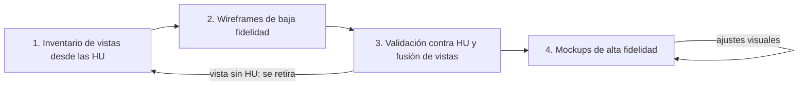
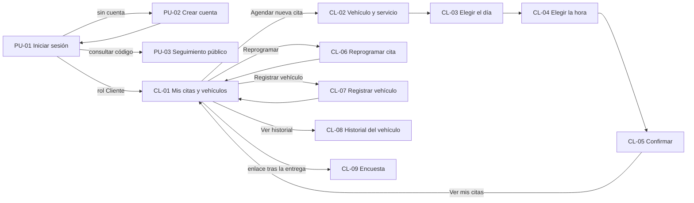
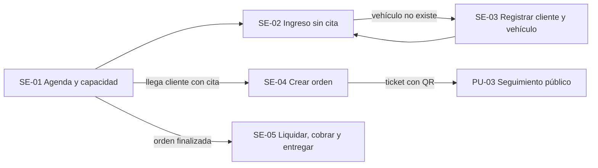
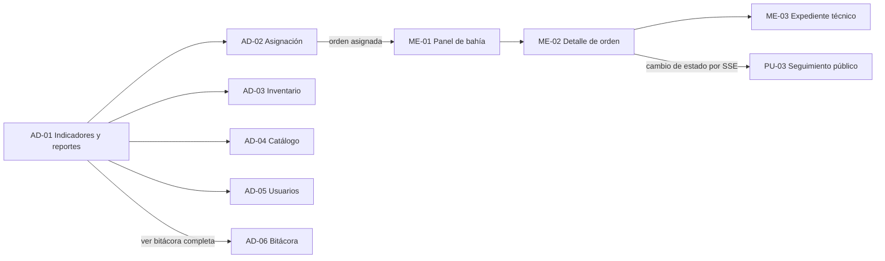

# Diseño de interfaz: wireframes y mockups

Documento del diseño de interfaz de Electrostock: cómo se diseñó, qué vistas existen, a qué HU responde cada una y con qué sistema visual se construyen. Es el entregable **"Wireframes y mockups"** de la rúbrica y el detalle de la sección 3.1.1 del [[IS-1-SRS-IEEE830|SRS]].

| Campo | Valor |
|---|---|
| Versión | 3.0 (26 vistas por dispositivo, sistema visual Riso wa-iro) |
| Fecha | 2 de noviembre de 2026 |
| Estado | Wireframes validados; mockups completos en web y móvil |
| Arquitectura frontend | [[IS-1-SRS-IEEE830#3.5.3 Arquitectura frontend Angular|SRS 3.5.3]] |

---

## 1. Archivos de diseño

| Archivo | Contenido | Enlace |
|---|---|---|
| **wireframe3** | Baja fidelidad validada: 26 vistas en web (1440) y móvil (360), 14 componentes en escala de grises | [Web](https://www.figma.com/design/UQGO3YgZtZWWCPKwuVB5hL/wireframe3?node-id=8-182) · [Móvil](https://www.figma.com/design/UQGO3YgZtZWWCPKwuVB5hL/wireframe3?node-id=8-183) · [Componentes](https://www.figma.com/design/UQGO3YgZtZWWCPKwuVB5hL/wireframe3?node-id=8-181) |
| **makups3** | Alta fidelidad: las mismas 26 vistas en web y móvil, sistema visual, 27 componentes | [Fundamentos](https://www.figma.com/design/T38ZyWWOsVMkIrnYdc5c1i/makups3?node-id=15-2) · [Componentes](https://www.figma.com/design/T38ZyWWOsVMkIrnYdc5c1i/makups3?node-id=15-3) · [Web](https://www.figma.com/design/T38ZyWWOsVMkIrnYdc5c1i/makups3?node-id=15-4) · [Móvil](https://www.figma.com/design/T38ZyWWOsVMkIrnYdc5c1i/makups3?node-id=15-5) |
| **Ingeniería de software: todo visual** | Diagramas del SRS y página de enlaces al diseño (UI-01) | [UI-01](https://www.figma.com/design/VuBSMD14Jm4Dt45rAGXTWd/Ingenieria-software-todovisual?node-id=3-246) |

**Organización de los archivos**

| Archivo | Página | Contenido |
|---|---|---|
| wireframe3 | Componentes | Imagen con X, logo, avatar, botones, línea de texto, campo, franja horaria, indicador, calendario de selección, calendario de ocupación, fotos provisionales, barra web, barra móvil |
| wireframe3 | Web / Móvil | Una sección por portal: Público, Cliente, Secretaria, Mecánico, Administrador |
| wireframe3 | Anterior - Web 1440 / Anterior - Móvil 360 | Versión previa, conservada como historial |
| makups3 | Fundamentos | Paleta, tipografía, texturas, ilustraciones de vehículos, principios y matriz de validación HU |
| makups3 | Componentes | Componentes de alta fidelidad, ilustraciones de vehículos (7 variantes) y fondo shippō |
| makups3 | Web / Móvil | Una sección por portal, igual que los wireframes |
| makups3 | Anterior - Fundamentos / Web 1440 / Móvil 360 | Mockups de la versión 2 (paleta "carga serena"), conservados como historial |

Cada pantalla se nombra `ID Nombre (HU)`, por ejemplo `CL-04 Agendar paso 3: elegir la hora (HU-01, HU-19)`, para que el ID se cite igual en las HU, el SRS y las pruebas.

---

## 2. Metodología

El diseño siguió un proceso iterativo de **diseño centrado en el usuario** (ISO 9241-210) en cuatro pasos:



1. **Inventario desde las HU.** Cada HU del backlog ([[IS-2-HU]]) se tradujo en las vistas que necesita su actor.
2. **Wireframes de baja fidelidad.** Escala de grises, imágenes como recuadros con X y textos como líneas, para discutir estructura y no estilo.
3. **Validación.** Cada vista se comparó con sus HU. Se fusionaron vistas que mostraban lo mismo, se retiraron las que no respondían a ninguna HU y se agregaron las que faltaban (sección 4).
4. **Mockups de alta fidelidad.** Se aplicó el sistema visual sobre la estructura validada, sin cambiar el contenido ni los ID.

**Normas y criterios aplicados**

| Norma o criterio | Aplicación |
|---|---|
| ISO 9241-210 | Diseño centrado en el usuario: vistas por rol y por tarea |
| WCAG 2.2 AA | Contraste ≥ 4,5:1 en texto, foco visible, estados con texto además de color |
| Heurísticas de Nielsen | Visibilidad del estado (contador, línea de tiempo), prevención de errores (solo transiciones válidas), lenguaje del usuario |
| ISO/IEC 25010 (capacidad de interacción) | RNF-17 a RNF-21 y RNF-31 del SRS |

---

## 3. Inventario de vistas
26 vistas por dispositivo, en web (1440) y móvil (360). La columna **Componente** es la carpeta Angular de [[IS-1-SRS-IEEE830#3.5.3 Arquitectura frontend Angular|SRS 3.5.3]].

### 3.1 Portal público

| ID | Vista | HU | Componente | POC |
|---|---|---|---|---|
| PU-01 | Iniciar sesión (incluye el portal de inicio) | HU-21; acceso a HU-07 | `identidad/iniciar-sesion` | Sí |
| PU-02 | Crear cuenta | HU-21 | `identidad/crear-cuenta` | Sí |
| PU-03 | Seguimiento público | HU-07 | `ordenes/seguimiento-publico` | Sí |

### 3.2 Portal del cliente

| ID | Vista | HU | Componente | POC |
|---|---|---|---|---|
| CL-01 | Mis citas y vehículos (incluye el panel del cliente) | HU-11, HU-22, HU-30 | `agenda/mis-citas-vehiculos` | Sí |
| CL-02 | Agendar paso 1: vehículo y servicio | HU-01, HU-19 | `agenda/agendar-cita` | Sí |
| CL-03 | Agendar paso 2: elegir el día | HU-01 | `agenda/agendar-cita` | Sí |
| CL-04 | Agendar paso 3: elegir la hora | HU-01, HU-19 | `agenda/agendar-cita` | Sí |
| CL-05 | Agendar paso 4: confirmar (incluye el estado de cita confirmada) | HU-01, HU-19 | `agenda/agendar-cita` | Sí |
| CL-06 | Reprogramar cita | HU-11 | `agenda/reprogramar-cita` | Sí |
| CL-07 | Registrar vehículo | HU-22 | `clientes-vehiculos/registrar-vehiculo` | Sí |
| CL-08 | Historial del vehículo | HU-30 | `clientes-vehiculos/historial-vehiculo` | No |
| CL-09 | Encuesta de satisfacción | HU-16 | `facturacion/encuesta` | No |

### 3.3 Portal de la secretaria

| ID | Vista | HU | Componente | POC |
|---|---|---|---|---|
| SE-01 | Agenda y capacidad (incluye el panel de recepción) | HU-02 | `agenda/agenda-capacidad` | No |
| SE-02 | Ingreso sin cita | HU-03, HU-04 | `agenda/ingreso-sin-cita` | Sí |
| SE-03 | Registrar cliente y vehículo | HU-22 | `clientes-vehiculos/registro-cliente-vehiculo` | Sí |
| SE-04 | Crear orden de trabajo | HU-23, HU-17 | `ordenes/crear-orden` | Sí |
| SE-05 | Liquidar, cobrar y entregar | HU-13, HU-17 | `facturacion/caja` | No |

### 3.4 Portal del mecánico

| ID | Vista | HU | Componente | POC |
|---|---|---|---|---|
| ME-01 | Panel de bahía | HU-05 | `ordenes/panel-bahia` | Sí |
| ME-02 | Detalle de orden | HU-05, HU-09, HU-25 | `ordenes/detalle-orden` | Sí (sin repuestos) |
| ME-03 | Expediente técnico | HU-06 | `clientes-vehiculos/expediente-tecnico` | Sí |

### 3.5 Portal del administrador

| ID | Vista | HU | Componente | POC |
|---|---|---|---|---|
| AD-01 | Indicadores y reportes | HU-14 | `reportes/indicadores-reportes` | No |
| AD-02 | Asignación de mecánicos | HU-24 | `ordenes/asignacion-mecanicos` | No |
| AD-03 | Inventario | HU-08, HU-27, HU-29 | `inventario/inventario-repuestos` | No |
| AD-04 | Catálogo y repuestos por servicio | HU-18, HU-26 | `catalogo/catalogo-repuestos-servicio` | Sí (HU-26) |
| AD-05 | Usuarios | HU-15 | `auditoria/usuarios` | No |
| AD-06 | Bitácora de auditoría | HU-20 | `auditoria/bitacora` | No |

### 3.6 HU sin vista propia

| HU | Motivo |
|---|---|
| HU-10 Autorización por rol | Transversal: son las guardias de todas las vistas y la autorización del backend |
| HU-12 Recordatorio automático | Proceso del sistema (outbox) |
| HU-28 Liberar reservas vencidas | Proceso del sistema; su efecto se ve en CL-04 (horas que se liberan) y SE-01 (ocupación) |

---

## 4. Decisiones de la validación

### 4.1 Fusiones
| Vistas originales | Vista resultante | Motivo |
|---|---|---|
| Portal de inicio + Iniciar sesión | PU-01 | El portal solo mostraba un mensaje y dos botones; cabe junto al formulario |
| Panel del cliente + Mis citas y vehículos | CL-01 | El panel repetía las citas y vehículos |
| Cita confirmada + Paso 4 confirmar | CL-05 | La confirmación es el estado final del mismo paso |
| Panel de recepción + Agenda y capacidad | SE-01 | Ambos mostraban la ocupación del día |
| Dashboard + Reportes | AD-01 | Los indicadores y los reportes usan el mismo rango de fechas |

### 4.2 Retiradas por no tener HU
- **Mis horas del mecánico:** ninguna HU registra horas trabajadas.
- **Bloques de horas y turnos del dashboard:** no hay HU de gestión de turnos.

### 4.3 Agregadas
- **CL-09 Encuesta de satisfacción** (HU-16): la HU existía y no tenía vista.
- **CL-07 Registrar vehículo** (HU-22): el cliente también registra sus vehículos con el mismo formulario.

### 4.4 Fotos del vehículo
Las vistas que necesitarán fotos (CL-07, CL-08, SE-02, SE-03, ME-02 y ME-03) muestran un **espacio provisional** con borde punteado y el rótulo "Fase posterior (ADR-15)". No se modificó ningún ADR ni se agregó un requisito: el espacio queda reservado para cuando la función se especifique.

---

## 5. Flujos de navegación

### 5.1 Portal público y cliente



### 5.2 Secretaria



### 5.3 Mecánico y administrador



---

## 6. Wireframes

**Estilo de baja fidelidad:** escala de grises, imágenes como recuadros con X, textos como líneas grises, botones oscuros, barra superior con logo y X de cierre (referencia: archivo `wireframe-ing.software`). Fuente Inter.

**Componentes de baja fidelidad (14):** imagen con X, logo, avatar, botón primario y secundario, línea de texto, campo, franja horaria, indicador, calendario de selección de día, calendario de ocupación, fotos provisionales, barra superior web y barra superior móvil.

**Patrones clave**
- **Agendar en 4 pasos** (CL-02 a CL-05) con barra de progreso: vehículo y servicio, día (calendario mensual), hora (franjas con estado), confirmar (contador de 5 minutos).
- **Calendario mensual** con domingos cerrados y días sin cupo punteados.
- **Franjas horarias** con cuatro estados: disponible, pocos cupos, sin cupo, seleccionada.
- **Panel de bahía** con una tarjeta por orden y solo los botones de las transiciones válidas.
- **Línea de tiempo** en el seguimiento público y en el detalle de orden.

---

## 7. Mockups: sistema visual Riso wa-iro

### 7.1 Concepto
Colores tradicionales japoneses (*wa-iro*) apagados sobre la técnica de imprenta **risograph**. Una masa fría de índigos agrisados, como el teñido *aizome*, sobre la que aparecen acentos cálidos suaves de gardenia y caqui. Saturación baja y armonía por cercanía de tono: nada grita, todo se lee.

### 7.2 Paleta

| Token CSS | Nombre | Hex | Uso | Contraste |
|---|---|---|---|---|
| `--color-fondo` | Kon, índigo apagado | `#2B3A55` | Fondo de todas las vistas | Referencia |
| `--color-superficie` | Ai, índigo medio | `#3A4C6E` | Tarjetas y paneles | - |
| `--color-campo` | Tetsukon, índigo hierro | `#222E44` | Campos, barras superiores, filas | - |
| `--color-etiqueta` | Kamenozoki, celeste agrisado | `#9CC3BF` | Etiquetas, bordes, ondas, botón secundario | 4,5:1 sobre superficie |
| `--color-accion` | Kuchinashi, amarillo gardenia | `#E3C27A` | Botón principal, títulos, selección | 5,0:1 sobre superficie; texto Kon encima 6,7:1 |
| `--color-registro` | Kaki, caqui | `#C8724F` | Sombra desplazada, alertas, bordes de peligro | 3,3:1: solo uso gráfico |
| `--color-texto` | Kinari, papel washi | `#EFE8DA` | Texto de cuerpo | 7,0:1 sobre superficie |
| `--color-patron` | Índigo del patrón | `#3A4B69` | Líneas del fondo shippō | Decorativo |

**Reglas de color**
- El amarillo gardenia es la acción: un solo botón amarillo por bloque.
- El caqui nunca se usa como texto, porque su contraste no alcanza AA; va como sombra, borde o punto de estado.
- Ningún estado depende solo del color: cada insignia lleva texto (RNF-19).

### 7.3 Tipografía

| Uso | Fuente | Estilo |
|---|---|---|
| Títulos de página, logo y cifras de indicadores | Shippori Mincho | ExtraBold 24 a 32 |
| Títulos de sección | Shippori Mincho | Bold 15 a 26 |
| Cuerpo | Plus Jakarta Sans | Regular y Medium 13 a 15, en Kinari |
| Etiquetas | Plus Jakarta Sans | SemiBold 12,5, en Kamenozoki |
| Códigos (OT, CITA, SKU, series) | JetBrains Mono | Medium |

### 7.4 Texturas y micrográfica
| Recurso | Descripción | Dónde |
|---|---|---|
| Trama de semitonos | Puntos índigo recortados sobre manchas de gardenia y caqui | Ilustraciones, indicadores, código QR |
| Descalce de registro | Sombra caqui desplazada 2 a 4 px, sin desenfoque | Botón principal, selección, títulos, logo |
| Ondas en negativo | Líneas celestes continuas, en el margen inferior de cada vista | Todas las vistas, nunca sobre texto |
| Fondo shippō | Círculos entrelazados tradicionales, tono sobre tono | Fondo de todas las vistas, detrás del contenido |

### 7.5 Ilustraciones de vehículos
Siete ilustraciones vectoriales en un solo componente, `Ilustración de vehículo`, con la propiedad *Tipo*: cuerpo en gardenia con descalce caqui, ruedas en índigo hierro con borde celeste y un sol caqui como firma. El dibujo se centra y conserva su proporción en cualquier tamaño.

| Tipo | Vistas donde aparece |
|---|---|
| Bicicleta eléctrica | PU-02 (web) |
| Scooter | PU-01, CL-01, CL-02 |
| Patineta | CL-01, CL-02 |
| Moto eléctrica | PU-03, SE-02, ME-01 |
| Monorueda | Fundamentos (galería) |
| Microcoche | ME-01 |
| Cuadriciclo | ME-01 |

### 7.6 Componentes (makups3, página Componentes)

| Grupo | Componentes |
|---|---|
| Identidad | Logo (batería con descalce), avatar |
| Acciones | Botón primario, secundario, de peligro y neutro |
| Estados | Insignias: correcto, información, advertencia, alerta, neutra |
| Formularios | Campo, fila de dato |
| Agenda | Franja horaria (4 estados), calendario de selección de día, calendario de ocupación |
| Datos | Indicador con trama |
| Imágenes | Ilustración general, ilustración de vehículo (7 variantes), código QR, fotos del vehículo (espacio provisional) |
| Estructura | Barra superior web, barra superior móvil, fondo shippō |

**Insignias de estado de la orden y de la cita**

| Estado | Insignia |
|---|---|
| Confirmada, Entregada, Activo | Correcto (celeste) |
| En reparación, En diagnóstico, Reprogramada | Información (borde celeste) |
| Reservado, Sin asignar, Prioridad media | Advertencia (gardenia) |
| Inactivo, En alerta, Prioridad alta | Alerta (punto y borde caqui) |
| Atendida, Asignada, Ingresada, Prioridad baja | Neutra |

---

## 8. Microcopy clave

| Situación | Texto (es-CO) | Vista |
|---|---|---|
| Franja tomada por otro cliente | "Alguien acaba de tomar este cupo. Le sugerimos las 11:00 a. m." | CL-04 |
| Repuesto no disponible | "No tenemos {repuesto} disponible para este servicio en este momento." | CL-02 |
| Cancelación fuera de ventana | "Ya no es posible cancelar: faltan menos de 1 hora para su cita. Llame al taller." | CL-01, CL-06 |
| Transición inválida | "Esta orden no puede pasar de {actual} a {destino}. Pasos válidos: {lista}." | ME-02 |
| Sesión expirada | "Su sesión ha expirado. Inicie sesión de nuevo para guardar los cambios." | Todas |
| Seguimiento no encontrado | "No encontramos información con ese código. Verifique e intente de nuevo." | PU-03 |
| Error de servidor genérico | "No fue posible completar la acción. Intente de nuevo en unos segundos." | Todas |
| Modo demostración | "Modo demostración: los datos son de prueba y no se guardan." | Todas |

Cada texto tiene su equivalente en inglés en `assets/i18n/en`.

---

## 9. Accesibilidad y criterios de aceptación del diseño

- [x] Cada vista existe en web (1440) y móvil (360).
- [x] Cada vista conserva su ID y sus HU entre wireframe y mockup.
- [x] Texto de cuerpo y etiquetas con contraste AA (sección 7.2).
- [x] Estados con texto, no solo color.
- [x] Componentes reutilizables, sin colores sueltos en las vistas.
- [ ] Estados de carga, vacío, error y sin permiso diseñados para las vistas del POC.
- [ ] Textos verificados en inglés sin desbordes.
- [ ] Prototipo navegable de los tres flujos críticos: agendar (CL-02 a CL-05); ingreso sin cita y orden (SE-02 a SE-04); cambio de estado (ME-01 a ME-02).
- [ ] Versión tablet del panel de bahía (dispositivo objetivo del mecánico).

---

## 10. Matriz de validación HU por vista

| HU | Título | Vistas | POC |
|---|---|---|---|
| HU-01 | Agendar cita | CL-02, CL-03, CL-04, CL-05 | Sí, Carlos |
| HU-02 | Calendario semaforizado | SE-01 | No |
| HU-03 | Registrar llegada sin cita | SE-02 | Sí, Carlos |
| HU-04 | Clasificar ingreso no programado | SE-02 | No |
| HU-05 | Actualizar orden y cambiar estado | ME-01, ME-02 | Sí, Joseph |
| HU-06 | Expediente técnico | ME-03 | Sí, Santiago |
| HU-07 | Seguimiento público | PU-03, acceso desde PU-01 | Sí, Santiago |
| HU-08 | Alertas de inventario | AD-03 | No |
| HU-09 | Registrar instalación de repuestos | ME-02 | No |
| HU-10 | Autorización por rol | Transversal | Base |
| HU-11 | Cancelar o reprogramar cita | CL-01, CL-06 | Sí, Joseph |
| HU-12 | Recordatorio automático | Sin vista: proceso automático | No |
| HU-13 | Liquidar, cobrar y entregar | SE-05 | No |
| HU-14 | Reportes operativos | AD-01 | No |
| HU-15 | Gestión de usuarios | AD-05 | No |
| HU-16 | Encuesta de satisfacción | CL-09 | No |
| HU-17 | Ticket PDF | SE-04, SE-05 | No |
| HU-18 | Catálogo de servicios | AD-04 | No |
| HU-19 | Reserva de repuestos al agendar | CL-02, CL-03, CL-04, CL-05 | Sí, Joseph |
| HU-20 | Bitácora de auditoría | AD-06, enlace desde AD-01 | No |
| HU-21 | Registro e inicio de sesión | PU-01, PU-02 | Sí, Santiago |
| HU-22 | Registrar cliente y vehículo | SE-03, CL-07 | Sí, Carlos |
| HU-23 | Crear orden de trabajo | SE-04 | Sí, Joseph |
| HU-24 | Asignar mecánico | AD-02 | No |
| HU-25 | Agregar repuestos a la orden | ME-02 | No |
| HU-26 | Repuestos por servicio | AD-04 | Sí, Carlos |
| HU-27 | Entradas y bajas de inventario | AD-03 | No |
| HU-28 | Liberar reservas vencidas | Sin vista: proceso automático; efecto en CL-04 y SE-01 | Sí, Santiago |
| HU-29 | Registrar repuestos | AD-03 | No |
| HU-30 | Historial de servicios | CL-08, enlace desde CL-01 | No |

**Resultado:** las 30 HU quedan cubiertas; 27 tienen vista; HU-10 es transversal y HU-12 y HU-28 son procesos del sistema.

---

## 11. Historial de versiones del diseño

| Versión | Fecha | Cambio |
|---|---|---|
| 1.0 | 28/10/2026 | 23 pantallas P-01 a P-23 con paleta azul (wireframes en texto, Apéndice A) |
| 2.0 | 28/10/2026 | Mockups de 15 pantallas del POC con la paleta "carga serena" (makups3, páginas *Anterior*) |
| 3.0 | 02/11/2026 | 26 vistas validadas por portal en wireframe3 y makups3; sistema visual Riso wa-iro; ilustraciones de vehículos y fondo shippō |

---

## Apéndice A. Diseño de la versión 1.0
Se conserva como historial. Las pantallas P-XX se reemplazaron por las vistas de la sección 3 según esta correspondencia:

| Versión 1.0 | Versión 3.0 |
|---|---|
| P-01 Inicio de sesión | PU-01 |
| P-02 Registro de cliente | PU-02 |
| P-03 Agendar cita (asistente de 4 pasos) | CL-02 a CL-05 |
| P-04 Mis citas | CL-01 |
| P-05 Reprogramar cita | CL-06 |
| P-06 Seguimiento público | PU-03 |
| P-07 Ingreso sin cita, triage y cola | SE-02 |
| P-08 Registro de cliente y vehículo | SE-03 |
| P-09 Crear orden | SE-04 |
| P-10 Panel de bahía | ME-01 |
| P-11 Detalle de orden en bahía | ME-02 |
| P-12 Expediente técnico | ME-03 |
| P-13 Repuestos requeridos por servicio | AD-04 |
| P-14 Calendario semaforizado | SE-01 |
| P-15 Inventario y alertas | AD-03 |
| P-16 Liquidación, pago y entrega | SE-05 |
| P-17 Asignación de mecánicos | AD-02 |
| P-18 Usuarios | AD-05 |
| P-19 Reportes | AD-01 |
| P-20 Bitácora de una orden | AD-06 |
| P-21 Historial del vehículo | CL-08 |
| P-22 Encuesta de satisfacción | CL-09 |
| P-23 Catálogo de servicios | AD-04 |
| (no existía) | CL-07 Registrar vehículo |

**Paleta de la versión 1.0**

| Token | Hex | Uso |
|---|---|---|
| `--color-primario` | `#1D4ED8` | Acciones primarias, enlaces |
| `--color-primario-oscuro` | `#1E3A8A` | Barra superior, *hover* primario |
| `--color-exito` | `#047857` | Confirmado, disponible, listo |
| `--color-advertencia` | `#B45309` | Capacidad media, umbral, contador < 1 min |
| `--color-peligro` | `#B91C1C` | Agotado, error, cancelar, riesgo eléctrico |
| `--color-texto` | `#0F172A` | Texto principal |
| `--color-texto-secundario` | `#475569` | Texto de apoyo |
| `--color-fondo` | `#F8FAFC` | Fondo |
| `--color-superficie` | `#FFFFFF` | Tarjetas, formularios |
| `--color-borde` | `#E2E8F0` | Bordes y divisores |
| `--color-foco` | `#2563EB` | Anillo de foco de 3 px |

**Wireframes en texto de la versión 1.0**

P-03 Agendar cita, móvil 360:

```text
┌──────────────────────────────┐   ┌──────────────────────────────┐
│ ← Agendar cita        1 de 4 │   │ ← Agendar cita        2 de 4 │
│ ●──○──○──○                   │   │ ●──●──○──○                   │
│                              │   │ Mar 03/11/2026  ◀  ▶         │
│ Vehículo                     │   │                              │
│ [ Scooter Xiaomi 4 Pro   ▼ ] │   │ [08:00 Disponible ●]         │
│   Serie SC-48-0001           │   │ [09:00 Pocos cupos ◐]        │
│                              │   │ [10:00 Agotado  x ] (gris)   │
│ Servicio                     │   │ [11:00 Disponible ●]         │
│ ( ) Diagnóstico general 1 h  │   │  ...                         │
│ (•) Cambio de batería  1 h   │   │ Requiere 1 franja (1 h)      │
│ ( ) Cambio controlador 2 h   │   │                              │
│                              │   │                              │
│ [        Continuar         ] │   │ [        Continuar         ] │
└──────────────────────────────┘   └──────────────────────────────┘
┌──────────────────────────────┐   ┌──────────────────────────────┐
│ ← Confirmar           3 de 4 │   │ Cita confirmada       4 de 4 │
│ Reservado por 04:32 (reloj)  │   │         ✓                    │
│ Mar 03/11 · 09:00 - 10:00    │   │   CITA-20261103-0007         │
│ Cambio de batería  $40.000   │   │ Mar 03/11/2026 · 9:00 a. m.  │
│ Repuestos apartados:         │   │ Scooter Xiaomi 4 Pro         │
│  ✓ Batería 48V 15Ah  x1      │   │ Repuestos garantizados       │
│ Puede cancelar hasta 1 h     │   │ Puede cancelar hasta las     │
│ antes de la cita.            │   │ 8:00 a. m. del 03/11         │
│ [    Confirmar cita        ] │   │ [   Ver mis citas          ] │
│ [ Cancelar ]                 │   │                              │
└──────────────────────────────┘   └──────────────────────────────┘
```

Decisiones que se mantienen en la versión 3.0: el contador de 5 minutos siempre visible; al expirar, un diálogo explica que el cupo se liberó; la franja agotada se muestra con texto, no se oculta; si falta un repuesto se dice cuál (RN-08); el cliente hace 3 acciones y la cuarta pantalla solo confirma (RNF-31). En la versión 3.0 el paso de la franja se dividió en día (calendario) y hora.

P-06 Seguimiento público, móvil 360:

```text
┌──────────────────────────────┐
│ Electrostock · Seguimiento   │
│ Código [ K7M2-QX9P-4T ] [Ir] │
│──────────────────────────────│
│ Scooter · Xiaomi 4 Pro       │
│ ┌──────────────────────────┐ │
│ │  EN REPARACIÓN  (azul)   │ │
│ └──────────────────────────┘ │
│ Entrega estimada: hoy 4 p. m.│
│                              │
│ ● Ingresada      8:05 a. m.  │
│ ● Asignada       8:20 a. m.  │
│ ● En diagnóstico 8:40 a. m.  │
│ ◉ En reparación  9:30 a. m.  │
│ ○ Finalizada                 │
│ ○ Lista para entrega         │
│ Se actualiza en tiempo real ⟳│
└──────────────────────────────┘
```

Sin nombre del cliente, costos ni datos del mecánico (RNF-15). El código se puede escanear desde el QR del ticket.

P-07 Ingreso sin cita, escritorio 1440:

```text
┌───────────────────────────────────────────────────────────────────────┐
│ Electrostock | Recepción      Hoy 03/11 · Ocupación 7/9 ◐   Ana ▼    │
├──────────────────────────────┬────────────────────────────────────────┤
│ Registrar ingreso sin cita   │ Cola de hoy                (en vivo)   │
│ Buscar vehículo              │ # Hora  Vehículo     Prioridad Estado  │
│ [ Serie, placa o documento ] │ 1 10:00 SC-48-0001   ALTA      Franja  │
│ → Moto eléctrica NIU NQi     │ 2 11:00 MO-72-0004   MEDIA     Franja  │
│   Serie MO-72-0004           │ 3 ~14:30 PT-36-0002  BAJA      Espera  │
│ Tipo de falla *              │                                        │
│ [ Frenos sin respuesta  ▼ ]  │ Citas confirmadas no se desplazan.     │
│ Prioridad: ALTA · 60 min     │                                        │
│ Motivo / observaciones       │                                        │
│ [                         ]  │                                        │
│ [ Registrar ingreso ]        │                                        │
└──────────────────────────────┴────────────────────────────────────────┘
```

P-10 Panel de bahía, tablet 1024 horizontal:

```text
┌────────────────────────────────────────────────────────────────┐
│ Mis órdenes · Andrés (Mecánico)              ⟳ en vivo   Salir │
├────────────────────────────────────────────────────────────────┤
│ ┌───────────────────────┐ ┌───────────────────────┐            │
│ │ OT-000001  ALTA       │ │ OT-000006             │            │
│ │ Scooter Xiaomi 4 Pro  │ │ Moto NIU NQi          │            │
│ │ [EN DIAGNÓSTICO]      │ │ [ASIGNADA]            │            │
│ │ Batería no carga      │ │ Revisión de frenos    │            │
│ │ ┌──────────────────┐  │ │ ┌──────────────────┐  │            │
│ │ │ ▶ En reparación  │  │ │ │ ▶ Iniciar diagn. │  │  56 px     │
│ │ └──────────────────┘  │ │ └──────────────────┘  │            │
│ │ ┌──────────────────┐  │ │                       │            │
│ │ │ || Esperar repues│  │ │                       │            │
│ │ └──────────────────┘  │ │                       │            │
│ └───────────────────────┘ └───────────────────────┘            │
└────────────────────────────────────────────────────────────────┘
```

Solo aparecen como botones las transiciones válidas desde el estado actual. Un toque aplica la acción y un segundo toque la confirma en un diálogo breve (RNF-18).
